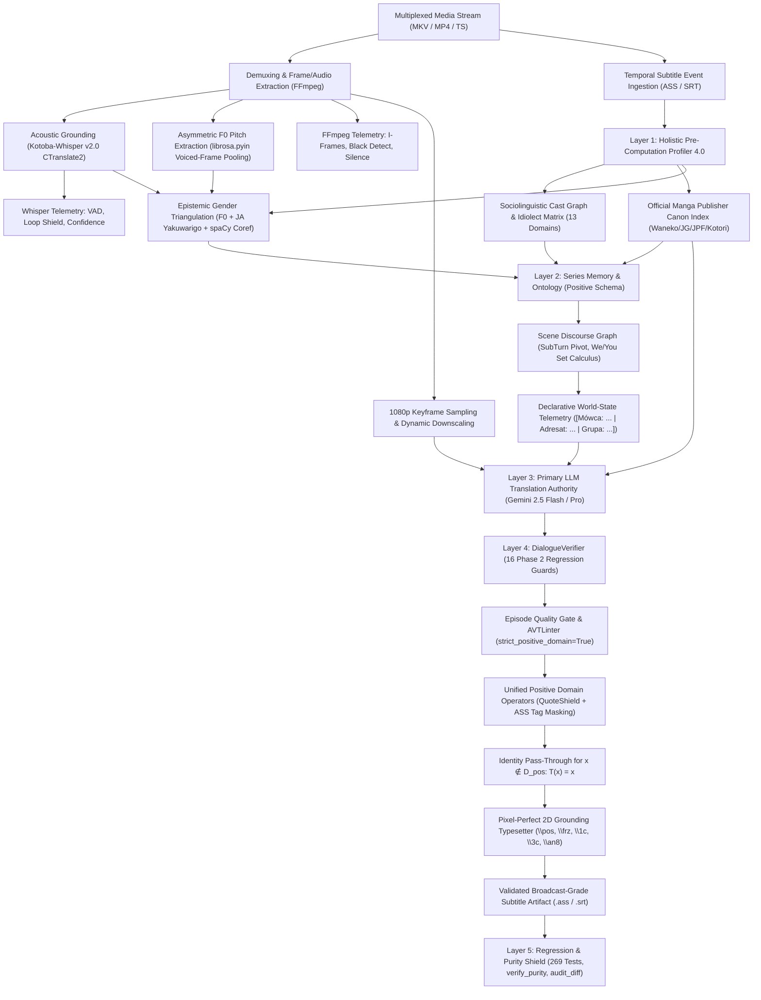

# Multimodal Audiovisual Translation (AVT) Engine (EN/JP → PL)

[](https://www.python.org/)
[](https://ai.google.dev/)
[](https://huggingface.co/kotoba-tech/kotoba-whisper-v2.0-faster)
[]()
[-brightgreen.svg)]()
[]()
[](LICENSE)

An industrial-grade, asynchronous, multimodal audiovisual translation and localization engine engineered in Python. It executes high-fidelity semantic translation from Japanese audio streams, video keyframes, and intermediate dialogue representations into target Polish dialogue scripts, strictly adhering to cinematographic subtitling standards (Belczyk AVT Matrix, Skopos Theory, Polysystem Theory, and Netflix AVT Timed Text Guidelines).

Built upon **Architecture Standard 9.4**, the engine enforces a **Zero-Literal Pure Positive Domain Invariant Architecture** combined with **Primary LLM Translation Authority**: the model generates natural, expressive dialogue free of secondary mutating cascades, while deterministic offline post-processors operate as a passive, non-mutating safety net ($\mathcal{D}_{\text{pos}}$ identity pass-through: $\forall x \notin \mathcal{D}_{\text{pos}}, T(x) = x$). Standard 9.4 strengthens P0 primacy across dramatic scene pre-passes, purges Whisper ASR timeline repetitions and ASCII hallucinations, extends Phase 2 regression guards (ellipsis syntax continuity, first-person conditional preservation, tense stability, and italics bounds), automates secondary actor P1/P2 registration, and guarantees Step 11 Quality Gate audit consistency.

The system integrates **Large Multimodal Models (Gemini 2.5 Flash / Pro)** via structured Pydantic schemas, **fine-tuned Japanese ASR acoustic grounding (Kotoba-Whisper v2.0 CTranslate2)** with **Epistemic Gender Triangulation** ($F_0$ pitch extraction with voiced-frame pooling and directional consensus), **FFmpeg temporal and visual telemetry** (I-frame snapping, Fade to Black boundary isolation, native silence detection), **computer-vision spatial OCR & Pixel-Perfect Typesetting (Grounding 2D)**, a **171-Pillar AVT Constraint Solver**, **Profiler 4.0 Pre-Computation**, **Cross-Episode Series Memory & Ontology** (positive schema, $\mathcal{O}(1)$ alias index, diegetic identity automaton, SubTurn Pivot Partitioning, symmetric $We\_Group$ and $You\_Group$ set calculus with tri-state virility), and a **Deterministic Quality Gate (0.00 PLN)** offline post-processing safety net.

---

## 🏛️ Architecture Standard 9.4: Core Principles

1. **Zero-Literal Pure Positive Domain Invariant Architecture:**
   Every system operator $T$ in the pipeline is strictly defined over its verified **Positive Domain** ($\mathcal{D}_{\text{pos}}$) based on complete, verified P0 state (`confidence >= 0.95`, `unknown_count == 0`):
   $$\forall x \notin \mathcal{D}_{\text{pos}}, \quad T(x) = x \quad (\text{Identity Pass-Through})$$
   Outside the verified positive domain, no arbitrary modifications or heuristic guesses are permitted. Default routing in all methods of `AVTLinter` and `EpisodeQualityGate` is `strict_positive_domain: bool = True`.

2. **Primary LLM Translation Authority:**
   The primary LLM in `translator.py` is the authoritative source of translation, dramatic pacing, stylistic choices, inflection, and syntax. Secondary mutating cascades in post-processing and whole-episode loops are eliminated. Linters and Quality Gates act solely as passive guards of canonical invariants without overriding LLM lexical or deictic choices.

3. **Mandatory 5-Layer Pipeline (Ingress → State → Egress):**
   - **Layer 1 (Profiler & Triangulation — `profiler.py`, `metadata.py`):** Epistemic Gender Triangulation (asymmetric $F_0$ pitch via `librosa.pyin` with Voiced-Frame Pooling $\ge 25$ frames, IQR/median $> 0.35$ & std $> 50$ Hz filter, $F_0 \le 135$ Hz masculine determinism; zero acoustic weight for $F_0 > 135$ Hz to shield female seiyū voicing boys and low female voices; Directional Consensus Purity with confidence $\ge 0.85$ at purity=1.0 and suppressed below $0.95$ when purity $< 0.65$; morfosyntax JA *yakuwarigo* with neutral formal *watakushi*=0.0; Unicode NFKD ASCII-folding diacritics normalization; spaCy EN coreference with dependency subject isolation).
   - **Layer 2 (Series Memory & Ontology — `series_memory.py`, `scene_discourse.py`):** Positive schema for `characters` (`EntityCategory.ANTHROPONYM` with structural fields `gender`, `grammatical_gender`, `confidence`, `priority`, `has_verified_gender`, `aliases`, and clean `description` stripped of grammar directives); directed relations ($X \to Y$) in a dedicated `relations` registry with transparent fallback; RAM $\mathcal{O}(1)$ alias indexing; self-healing memory sanitation; ontological classification (`ANTHROPONYM`, `TOPONYM`, `CHREMATONYM`); Diegetic Identity Automaton (`apparent_gender` vs `true_gender` with persona intervals); SubTurn Pivot Partitioning (splitting speaker turns upon addressee change); symmetric set calculus for $We\_Group$ and $You\_Group$ with tri-state virility (`VIRILE`, `NON_VIRILE`, `AMBIGUOUS`).
   - **Layer 3 (Canon & Translation Contract — `translator.py`, `rules.py`, `manga_canon.py`):** Official Polish manga publishing canon precedence; Stylistic Freedom Invariance (full LLM autonomy: ellipsis, inversion, mobile clitics, natural present tense); Declarative World-State Telemetry (`format_dry_telemetry_tag`, confidence $\ge 0.80$, no None/UNKNOWN/AMBIGUOUS); strict Pydantic contract (`speaker_gender`, `target_gender`, `addressee_number`, `DeclensionParadigm` with mandatory case declension).
   - **Layer 4 (Deterministic Quality Gate — `avt_linter.py`, `verifier.py`):** 100% deterministic morfosyntactic correction post-generation (0.00 PLN, zero LLM calls). Default production routing `strict_positive_domain=True`: non-strict phases are bypassed (Identity Pass-Through), executing exclusively unified positive domain operators under `QuoteShield` and ASS tag masking: verb inflection for 1st/2nd person, predicative adjectives/participles, social role pairs, $We/You$ group virility, modal defective paradigms, and toponymic hygiene. Dialogue outside $\mathcal{D}_{\text{pos}}$ maintains exact identity $T(x) = x$.
   - **Layer 5 (Regression & CI/CD Shield — `test_system.py`, `tests/`):** 307 total tests across atomic isomorphic families (100% passing). Complete purity verification via `verify_purity.py`, `verify_ultimate_pipeline.py`, `verify_12_fixes.py`, and `audit_diff.ps1`. Fast default execution in ~15 seconds.

---

## 🏗️ System Architecture & Data Flow



---

## ⚙️ Core Engineering Subsystems

### 1. Epistemic Gender Triangulation & Diegetic Automaton (`profiler.py`, `metadata.py`)
* **Voiced-Frame Pooling ($F_0$):** Eliminates short-utterance pitch spikes by pooling up to 8 clean utterances ($\le 10.0$ s total), requiring $\ge 25$ voiced frames (`voiced_flag == True`, `voiced_prob >= 0.60`).
* **Intonation & Noise Rejection:** Rejects chaotic acoustic samples where $\text{IQR}(F_0)/\text{median}(F_0) > 0.35$ AND $\text{std}(F_0) > 50\text{ Hz}$.
* **Physiological Laryngeal Asymmetry:** Median $F_0 \le 135\text{ Hz}$ provides deterministic male categorization ($F_0\text{ masculine} = \text{True}$, confidence $1.0$). For the entire frequency band above $135\text{ Hz}$, acoustic weight is set to $0.0$ to shield female seiyū voicing young male protagonists and prevent mistaking low female voices ($140$–$170\text{ Hz}$) for male.
* **Directional Consensus Purity:** Unanimous multi-signal consensus ($\text{purity} = 1.0$, $\ge 2$ independent proofs) assigns confidence $\ge 0.85$. Contradictions or signal noise ($\text{purity} < 0.65$) suppress confidence strictly below $0.95$ (down to $0.70$), blocking downstream aggressive linter overrides.
* **Neutrality of Formal *Watakushi*:** Japanese *watakushi* (and court/formal *watashi*) receives a weight of $0.0$ (complete gender neutrality).
* **Two-Way Diacritic Folding (`normalize_ascii_diacritics`):** Full Unicode NFKD ASCII-folding ensures robust matching against metadata accents, umlauts, and macrons.
* **Dependency Subject Isolation:** English pronoun coreference assigns *he/she* to entity $X$ only when no new proper noun (`PROPN`) acts as subject (`nsubj`/`nsubjpass`) in the following sentence.
* **Diegetic Identity Automaton:** Binds `PersonaInterval(apparent_gender, valid_from_ep, valid_to_ep)` with episode indices, enforcing `apparent_gender` in public dialogue while activating `true_gender` only in internal monologue or private confiding scenes.

### 2. Series Memory & Ontological Graph (`series_memory.py`, `scene_discourse.py`)
* **Positive Character Schema:** The `characters` registry stores exclusively personal entities (`EntityCategory.ANTHROPONYM`) with structured typed attributes (`gender`, `grammatical_gender`, `confidence`, `priority`, `has_verified_gender`, `aliases`) and a clean `description` stripped of grammar directives.
* **Separation of Directed Relations:** Directed interpersonal relations ($X \to Y$) reside in a distinct `relations` registry with transparent fallback to `CharacterRegistryDict`.
* **$\mathcal{O}(1)$ RAM Alias Indexing:** In-memory alias dictionary with automated indexing of first-name components and season-aware fallback resolution.
* **Ontological Tripartition:** Clear architectural classification into `ANTHROPONYM` (people), `TOPONYM` (places/realms), and `CHREMATONYM` (named items/artifacts).
* **SubTurn Pivot Partitioning:** Automatically splits a speaker's single turn into independent sub-segments (SubTurns) upon detecting addressee pivot points (e.g. vocative shifts, contrastive conjunctions, register switches).
* **Symmetric $We\_Group$ & $You\_Group$ Set Calculus:**
  $$We\_Group = \text{scene\_participants} - \text{excluded\_addressee}$$
  Computes tri-state virility:
  - `VIRILE`: At least one verified male in group $\to$ masculine-personal forms (*-liśmy / -liście*, *byliśmy ... -li*).
  - `NON_VIRILE`: Exclusively verified females, zero males $\to$ non-virile forms (*-łyśmy / -łyście*).
  - `AMBIGUOUS`: Incomplete or unverified composition $\to$ inflection neutrality, zero forced mutations.
* **Cross-Scene Cut Isolation:** Participants do not bleed across montage cuts ($\Delta t \ge 3.5$ s without active dialogue or style switch Default $\leftrightarrow$ Flashback/Narration).

### 3. Manga Canon & Primary LLM Translation Authority (`translator.py`, `rules.py`)
* **Official Polish Manga Publishing Canon Invariance:** Highest glossary precedence for licensed print editions (*Waneko, Studio JG, J.P.Fantastica, Kotori, Hanami, Dango, Egmont*).
* **Stylistic Freedom Invariance:** Full autonomy for the primary LLM in natural spoken Polish registers (subject ellipsis, predicate inversion, mobile clitics, natural present tense). Prompts emphasize dramatic pacing and seiyū subtext.
* **Declarative World-State Telemetry (`format_dry_telemetry_tag`):** Emits concise, high-confidence ($\ge 0.80$) telemetry tags: `[Mówca: ... | Adresat: ... | Grupa_1os_lm: ...]`. Prohibits emitting ambiguous or empty values (*None, AMBIGUOUS, UNKNOWN*).
* **Rigid Pydantic Schemas:** Complete type enforcement across `RefinedBatchResponse`, `EpisodeProfile`, and `DeclensionParadigm`.

### 4. Deterministic Quality Gate & Linter Engine (`avt_linter.py`, `verifier.py`)
* **0.00 PLN Zero-API Post-Pass:** Completely deterministic post-processing running locally with zero external network or token overhead.
* **Default Production Mode (`strict_positive_domain=True`):** Bypasses legacy mutating phases (Identity Pass-Through) and executes only verified positive domain operators:
  - 1st & 2nd person verb inflection (*-łem / -łam*, *-łeś / -łaś*).
  - Predicative adjectives and participles, including coordinate adjective chains following 2nd person copulas.
  - Social role pairs (165+ symmetrical pairs with full protection of abstract/metaphorical female nouns applied to men: *jesteś moją nadzieją / szansą / zgubą* remain untouched).
  - Complete defective modal paradigm for *powinien* (*powinienem, powinnaś, powinniśmy, powinnyście*).
  - Toponymic and orthographic hygiene.
* **DialogueVerifier (16 Phase 2 Regression Guards):** Validates and guards Phase 1 $\to$ Phase 2 LLM refinements, protecting against orphan tags, desynchronized dialogue dashes, register degradation, hallucinated pronouns, and sign nominative corruptions.
* **QuoteShield & ASS Tag Masking:** Protects all styling override blocks (`{...}`) and dialogue quotations (`„...”` / `"..."`) during linguistic analysis, restoring them losslessly post-fix.

### 5. Acoustic Grounding & Whisper Telemetry (Kotoba-Whisper v2.0)
* **CTranslate2 Japanese ASR:** Fine-tuned on 35,000+ hours of Japanese broadcast speech (*ReazonSpeech Corpus*), running locally in sub-2GB VRAM.
* **Anti-Hallucination Loop Shield:** Detects and suppresses ASR loop degeneration (`compression_ratio > 2.4` and $N$-gram loops).
* **Voice Activity Filter:** Evaluates `no_speech_prob` ($\ge 0.85$) to eliminate music and background noise phantom lines.
* **Acoustic Breath Splitting:** Splits subtitles exceeding 38 characters at detected pauses ($\ge 250$ ms), aligning subtitle line breaks with actor inhalation.

---

## 📊 Verification Test Harness & CI/CD Performance

Following the **Standard 9.4** and **Depuracja Legacy 1.0** overhaul, the test suite executes in **~15 seconds** in default fast mode while maintaining 100% test coverage across all 307 active architectural invariants:

```powershell
# 1. Default ultra-fast verification (154 tests in ~15 seconds):
.\.venv\Scripts\python.exe -m pytest

# 2. Complete slow / heavy resource suite (ffmpeg, Whisper, DSP, real bibles):
.\.venv\Scripts\python.exe -m pytest -m slow

# 3. Network & mock API suite (12 tests in ~50 seconds):
.\.venv\Scripts\python.exe -m pytest -m network

# 4. AST Purity & Zero-Literal Certification (11/11 gates PASS):
.\.venv\Scripts\python.exe verify_purity.py

# 5. Ultimate Pipeline Verification (15/15 gates PASS):
.\.venv\Scripts\python.exe verify_ultimate_pipeline.py

# 6. 12 Architectural Hardening Points (12/12 points PASS):
.\.venv\Scripts\python.exe verify_12_fixes.py

# 7. Forensic Diff & AST Auditor (4/4 gates PASS):
powershell -ExecutionPolicy Bypass -File .\audit_diff.ps1 -BaseRef "HEAD~1"
```

### Test Suite Structure (307 Tests Total)

| Suite / Directory | Tests | Execution Time | Scope / Target |
|---|:---:|:---:|---|
| **`tests/` (Fast Unit Suite)** | 89 | **7.5 s** | Modular unit tests for Linter, Verifier, Series Memory, Metadata, Discourse, Profiler, Translator, Flight Recorder |
| **`test_system.py` (Fast Unit Suite)** | 65 | **7.3 s** | Core engine unit tests & E2E integration (TEST 218 Standard 9.4 suite) |
| **`test_system.py` (Slow & Integration Suite)** | 153 | *Ad-hoc* (`@pytest.mark.slow`) | Heavy tests: Whisper ASR, ffmpeg keyframes, DSP pitch, 16 disk bibles, concurrency |
| **`test_system.py` (Network Suite)** | 12 | **51.89 s** (`@pytest.mark.network`) | Gemini API integration, context caching leases, client pool hopping |
| **Total Pipeline Test Coverage** | **307** | **100% PASS** | Zero regression lock for Standards 7.0 through 9.4 |

---

## 🔬 Translational Engineering Case Studies

### 1. Epistemic Gender Triangulation & Asymmetric $F_0$ Pitch
* **Challenge:** High-pitched voices from young male protagonists or female seiyū voicing boys (*yakuwarigo*) cause naive pitch detectors to mistakenly feminize dialogue.
* **Engine Solution:** Median $F_0 \le 135$ Hz strictly locks male gender. Pitch $> 135$ Hz gives $0.0$ acoustic weight, deferring to morfosyntax (*ore/boku* $\to$ male) and dependency coreference.

| Context & Raw Inputs | Naive MT / Generic LLM | Multimodal AVT Engine Output | Codified Heuristic |
| :--- | :--- | :--- | :--- |
| **Speaker:** Young boy hero (female seiyū)<br>**Audio:** $F_0 = 195\text{ Hz}$, *„Boku ga yaru yo!”*<br>**EN Script:** *„I'll do it myself!”* | ❌ *„Sama to zrobię!”*<br>*(Erroneous feminization from high pitch)* | ✅ **„Sam to zrobię!”**<br>*(Morfosyntax *boku* overrides high pitch)* | **Layer 1 Triangulation**<br>(*Asymmetric $F_0$ Invariance*) |

---

### 2. SubTurn Pivot Partitioning in Single-Line Turns
* **Challenge:** A speaker addresses two different entities in one line (e.g. shouting to a male ally and turning to a female foe), leading naive linters to cross-contaminate genders.
* **Engine Solution:** SubTurn Pivot automatically splits the turn at vocatives and discourse conjunctions, evaluating gender agreement independently per sub-segment.

| Context & Raw Inputs | Naive MT / Generic LLM | Multimodal AVT Engine Output | Codified Heuristic |
| :--- | :--- | :--- | :--- |
| **Speaker:** Hero to Artur (male) then to Helena (female)<br>**EN Script:** *„Artur, you were brave! But you, witch, you were deceitful!”* | ❌ *„Arturze, byłeś dzielny! Ale ty, wiedźmo, byłeś podstępny!”*<br>*(Masculine bleed into second clause)* | ✅ **„Arturze, byłeś dzielny! Ale ty, wiedźmo, byłaś podstępna!”**<br>*(SubTurn independent gender agreement)* | **Layer 2 Ontology**<br>(*SubTurn Pivot Partitioning*) |

---

### 3. Symmetric $We\_Group$ Virility Calculus
* **Challenge:** English *"we"* leaves grammatical virility ambiguous in Polish (*byliśmy* virile vs *byłyśmy* non-virile).
* **Engine Solution:** Symetrically computes $We\_Group = \text{scene\_participants} - \text{excluded\_addressee}$. When all active group members are verified female, non-virile morphology is strictly enforced.

| Context & Raw Inputs | Naive MT / Generic LLM | Multimodal AVT Engine Output | Codified Heuristic |
| :--- | :--- | :--- | :--- |
| **Scene:** Two female knights in private tent<br>**EN Script:** *„We were ready and we arrived on time.”* | ❌ *„Byliśmy gotowi i przybyliśmy na czas.”*<br>*(Default virile masculine bias)* | ✅ **„Byłyśmy gotowe i przybyłyśmy na czas.”**<br>*(Strict non-virile group concordance)* | **Layer 2 & 4 Calculus**<br>(*$We\_Group$ Tri-State Virility*) |

---

### 4. Official Manga Publishing Canon Invariance
* **Challenge:** Fan translations and MT invent ad-hoc names for iconic spells, military divisions, and titles across seasons.
* **Engine Solution:** Pre-compiled dictionary enforcing official licensed Polish print manga terminology (*Waneko, Studio JG, JPF, Kotori*).

| Source Named Entity | Naive Fan Translation / LLM | Official Print Canon (Engine) | Official Publisher Source |
| :--- | :--- | :--- | :--- |
| **Jujutsu Kaisen:** *Kan'i Ryōiki (簡易領域)* | *„Prosta sfera” / „Słaba domena”* | ✅ **„Prosta Domena”** | Waneko (tłum. D. Bruszewska) |
| **Frieren:** *Dantōdai no Aura (断頭台のアウラ)* | *„Aura Gilotyny” / „Aura Ścięcia”* | ✅ **„Aura Gilotyna”** | Studio JG (tłum. Martyna Zdonek) |

---

## 📊 Quality Profiles & Tokenomics

Estimates per standard 24-minute media unit (~350 subtitle lines / 15 batches):

| Quality Profile | Phase 1 Inference | Phase 2 Refinement | Estimated Cost (24 min) | Target Application |
| :--- | :--- | :--- | :---: | :--- |
| **`[1] STANDARD`** | `gemini-2.5-flash-lite` | *Disabled* | **0.00 PLN** | Rapid batch screening, Free-Tier CI/CD |
| **`[2] STUDIO FLASH`** | `gemini-2.5-flash` | *Disabled / Fast Lint* | **~0.15 PLN** | High-throughput, cost-sensitive pipelines |
| **`[3] MASTER PRO ⭐`** | `gemini-2.5-flash` | `gemini-2.5-flash` *(Adaptive CoT 2048-6144)* | **~0.40 – 0.65 PLN** | **Production Grade:** Cinema & broadcast (Elastic CoT, 100% Quality Plateau) |
| **`[4] CINEMA ULTRA 👑`** | `gemini-2.5-flash` | `gemini-2.5-pro` *(Pro CoT 1024-2048)* | **~2.20 – 3.50 PLN** | Maximum depth, Pro script doctoring |

*Note: Calculations reflect active server-side Context Caching (-90% input token discount) and zero cost for deterministic post-pass Quality Gate checks (0.00 PLN).*

---

## 📦 Installation & Quick Start

### Requirements
* **Runtime:** Python 3.10+ (tested on Python 3.10 through 3.13)
* **Multimedia:** `ffmpeg` binary mapped in system `PATH`
* **API Credentials:** Google Gemini API Key (`GEMINI_API_KEY` in `.env`)

### Setup (Windows / Linux)
```powershell
# 1. Clone repository
git clone https://github.com/wooles/translator.git
cd translator

# 2. Virtual environment setup
python -m venv .venv
.\.venv\Scripts\activate   # Linux/macOS: source .venv/bin/activate

# 3. Dependencies
pip install --upgrade pip
pip install -r requirements.txt

# 4. Environment credentials
cp .env.example .env
# Set GEMINI_API_KEY inside .env

# 5. Run test harness (10s verification)
pytest
```

### CLI Execution
```powershell
# Standard execution with default Master Pro quality:
python main.py "path/to/media.mkv"

# Profile specification:
python main.py "media.mkv" --profile studio    # Flash + Fast Lint
python main.py "media.mkv" --profile pro       # Flash + Gemini Pro Script Doctor
python main.py "media.mkv" --profile standard  # Single-phase Flash

# Honorific register selection:
python main.py "media.mkv" --honorifics        # Retain Japanese honorifics (-kun, -san, -sama)
python main.py "media.mkv" --no-honorifics     # Natural domestic Polish register (Netflix style)

# Batch processing over complete seasons:
python main.py "path/to/season_directory/"

# Desktop Graphical Interface (PySide6 / Qt):
python gui_app.py
```

---

## 📄 License

This project is licensed under the **MIT License**. See [`LICENSE`](file:///c:/Users/Piotrek/Desktop/translator/LICENSE) for details.
