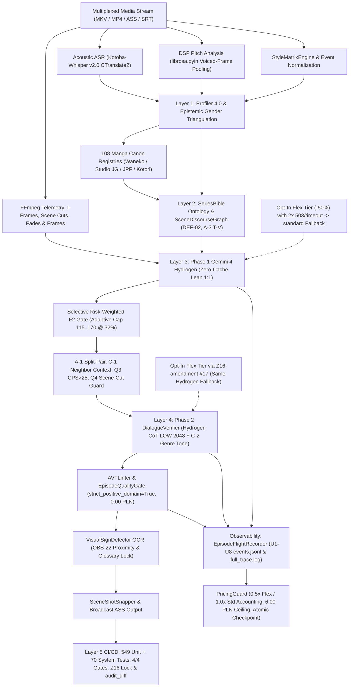

# Multimodal Audiovisual Translation (AVT) Engine (EN/JP → PL)

[](https://www.python.org/)
[-orange.svg)](https://ai.google.dev/)
-teal.svg)
[](https://huggingface.co/kotoba-tech/kotoba-whisper-v2.0-faster)
-purple.svg)
-brightgreen.svg)
-blueviolet.svg)


An industrial-grade, asynchronous, multimodal audiovisual translation and localization engine engineered in Python. It executes high-fidelity semantic translation from Japanese audio streams, 1080p video keyframes, and English/intermediate subtitle tracks into natural Polish dialogue scripts, strictly adhering to professional Polish subtitling standards (Belczyk AVT Matrix, Skopos Theory, Polysystem Theory, and Netflix AVT Timed Text Guidelines).

Built on **Architecture Standard 12.2.4 (`S2` Opt-In Gemini Flex Inference across F1 & F2 via `Z16-amendment #17` + exact `0.5x` Flex rate accounting)**, the pipeline runs `gemini-4-hydrogen` in Zero-Cache Lean 1:1 production mode with optional `-50%` Gemini Flex batching (`AVT_SERVICE_TIER=flex`, defaulting safely to `"standard"`), deterministic `2x 503/timeout -> standard` fallback on the same Hydrogen model before any model downgrade, full black-box telemetry (`EpisodeFlightRecorder` U1–U8), and strict `Z16` diff-lock governance (`0.00 PLN` deterministic post-processing).

The system combines **multimodal LLM inference** with **Kotoba-Whisper v2.0 CTranslate2 Japanese ASR**, **Epistemic Gender Triangulation** (voiced-frame $F_0$ pitch pooling, Japanese *yakuwarigo*, and `spaCy` dependency coreference), **FFmpeg temporal telemetry** (I-frame snapping, Fade-to-Black cut isolation, silence detection), **spatial visual OCR & Pixel-Perfect ASS Typesetting**, a **171-Pillar AVT Constraint Solver**, **Profiler 4.0**, **Cross-Episode Series Memory** (`ANTHROPONYM` / `TOPONYM` / `CHREMATONYM` ontology + `SubTurn` discourse graph), and an offline **Deterministic Quality Gate**.

### Key Capabilities at a Glance

* **Production Literary Quality:** **`~9.0/10`** natural Polish dialogue fluency with **`<0.3%`** residual error rate verified across **`1,201+`** audited production lines.
* **Lean Unit Economics:** **`~0.64 – 1.19 gr/line`** depending on billing tier (**`~2.22 – 2.75 PLN net`** per 24-min episode in opt-in Flex mode vs **`~3.85 – 5.35 PLN net`** in Standard mode), protected by a hard **`6.00 PLN`** Fail-Closed session ceiling.
* **Canonical Knowledge Coverage:** **`108`** tracked [Manga Canon publisher registries](manga_canon), **`20`** tracked [SeriesBible databases](series_memory), and **`42`** tracked [fansub style lexicons](series_memory/fansub_lexicons).
* **Zero-Cost Local Verification (`0.00 PLN`):** Acoustic ASR, $F_0$ pitch DSP, FFmpeg scene snapping, morfosyntactic `AVTLinter`, and `EpisodeQualityGate` execute 100% locally offline.
* **Resilient Multi-Key & Atomic Recovery:** Built-in multi-key rotation pool (`MultiKeyClientPool`), automatic Healing Pass for Zero-Gap line delivery, and crash-safe atomic `.checkpoint.json` writes.

---

## 🏗️ System Architecture & Data Flow (Standard 12.2.4)



---

## 🏛️ Core Architecture & 12.x Engineering Highlights

1. **Zero-Literal Pure Positive Domain Invariant ($\mathcal{D}_{\text{pos}}$):**
   Every deterministic post-processing operator $T$ is defined strictly over complete, verified P0 ontological state (`confidence >= 0.95`, `unknown_count == 0`):
   $$\forall x \notin \mathcal{D}_{\text{pos}}, \quad T(x) = x \quad (\text{Identity Pass-Through})$$
   Default routing across [avt_linter.py](avt_linter.py) (`AVTLinter` and `EpisodeQualityGate`) is `strict_positive_domain: bool = True`.

2. **Primary LLM Translation Authority:**
   [translator.py](translator.py) acts as the authoritative source of literary style, dramatic rhythm, ellipsis, and Polish syntax, while post-pass linters and Phase 2 regression guards strictly enforce canonical invariants without overriding natural LLM phrasing.

3. **Zero-Cache Lean 1:1 & Opt-In Gemini Flex Inference (`12.0.0`, `12.2.3`, `12.2.4`):**
   - **Flagship Quality-First Architecture:** `gemini-4-hydrogen` runs in Lean 1:1 mode (`AVT_CONSOLIDATE_F2=0`), preserving local batch focus and CoT efficiency (`LOW 2048` in Phase 2) without Flash quality regressions.
   - **Opt-In `-50%` Gemini Flex Tier (`Q2` + `S2`):** Configured via `AVT_SERVICE_TIER=flex` (default `"standard"`) through shared helpers in [model_resolver.py](model_resolver.py) across Phase 1 ([translator.py](translator.py), [profiler.py](profiler.py), [sign_detector.py](sign_detector.py)) and Phase 2 ([verifier.py](verifier.py) via authorized `Z16-amendment #17`). Upon `2` consecutive `503` or `TimeoutError` failures in `flex` mode, execution falls back deterministically to `"standard"` on the **exact same Hydrogen model** before any fallback to Flash.
   - **Exact Mixed-Tier Accounting (`Z16-amendment #17`):** [pricing_guard.py](pricing_guard.py) (`calculate_actual_cost_breakdown`) and session token counters (`flex_prompt`, `flex_cached`, `flex_output` + atomic checkpoints in [translator.py](translator.py)) compute `0.5x` Flex and `1.0x` Standard rates accurately across mixed fallback runs.

4. **Adaptive Selective Phase 2 & Discourse Coherence (`12.1.0`, `12.2.0`, `12.2.1`, `12.2.3`):**
   - **Adaptive Episode Scaling (`Q1`):** `_compute_adaptive_f2_episode_cap` scales Phase 2 coverage dynamically as `max(115, min(170, int(0.32 * total_lines)))` for longer episodes while preserving the `115`-line baseline on shorter episodes.
   - **Extreme CPS Priority & Dense Sign Protection (`Q3` + `12.2.3a`):** Dialogues exceeding `25.0 CPS` receive `cps_extreme:+60` priority and bypass `trivial_short` suppression, while multi-word complex visual inscriptions (`>= 10` words and `>= 75` chars) retain F2 priority (`long_sign_banner:+60`) without promoting trivial banners (`score == 0`).
   - **Discourse, Typography & OCR Safeguards:** `Q4` actorless scene-cut lowercase guard (`>= 3.5 s`), `A-1` split-sentence & echo pairing, `A-3` directed T-V register control, `C-1` read-only neighbor context, `C-2` genre-adaptive F2 tone, `OBS-13` Z2 addressee confidence threshold (`>= 0.90`), `OBS-19/20` ASS trailing-period and multiline italic hygiene, `OBS-22` Sign OCR `3000 ms` proximity filter with locked glossary enforcement, and `OBS-23` Profiler catchphrase resolution priority.

5. **Full Black-Box Observability (`EpisodeFlightRecorder` — `12.2.2 + 12.2.2a`):**
   - Emits structured machine-readable telemetry to `events.jsonl` alongside human-readable diagnostics in `full_trace.log` (`U1–U8`) via [pipeline_logger.py](pipeline_logger.py) and [flight_recorder.py](flight_recorder.py).
   - Captures per-line Phase 2 risk scores and reasons (`f2_score`, `f2_score_reasons`, `f2_not_selected_reason`), FBF-safe `line_ids` mappings, `notes_meta` (`A-1`/`A-3`/`C-1`/`OBS-13c`), raw Phase 2 drafts (`f2_raw_pl`), post-F2 fixes (`post_f2_fixes`), `EpisodeQualityGate` diffs (`eqg_diffs`), F1 `thoughts` tokens, `budget_audit` lifecycle events, API retry telemetry, and crash-safe atomic `.checkpoint.json` updates (`.tmp` + `fsync` + `os.replace`).

---

## ⚙️ Core Engineering Subsystems

* **Layer 1 — Epistemic Gender Triangulation & Acoustic Grounding ([profiler.py](profiler.py), [metadata.py](metadata.py), [whisper_engine.py](whisper_engine.py)):** Pools up to `8` clean utterances (`<= 10.0 s`, `>= 25` voiced frames) via `librosa.pyin`, rejects unstable intonation ($\text{IQR}/\text{median} > 0.35$ and $\text{std} > 50\text{ Hz}$), enforces deterministic masculine weighting only for $F_0 \le 135\text{ Hz}$ (`0.0` acoustic weight above `135 Hz` to shield female seiyū voicing boys), pairs *Kotoba-Whisper v2.0* CTranslate2 ASR (`compression_ratio <= 2.4` loop shield, `no_speech_prob >= 0.85` VAD filter, `>= 250 ms` breath splitting) with *yakuwarigo* morfosyntax (`watakushi = 0.0` neutrality), NFKD diacritic folding, `spaCy` subject isolation, and diegetic `PersonaInterval` tracking.
* **Layer 2 — Series Memory & Ontological Graph ([series_memory.py](series_memory.py), [scene_discourse.py](scene_discourse.py)):** Enforces positive `EntityCategory.ANTHROPONYM` schemas (separate directed `relations` graph), $\mathcal{O}(1)$ RAM alias lookups, cross-scene montage isolation ($\Delta t \ge 3.5\text{ s}$), `SubTurn` vocative pivot splitting, and symmetric $We\_Group = \text{scene\_participants} - \text{excluded\_addressee}$ tri-state virility (`VIRILE`, `NON_VIRILE`, `AMBIGUOUS`).
* **Layer 3 — Official Manga Canon & Telemetry Contract ([manga_canon.py](manga_canon.py), [rules.py](rules.py)):** Enforces licensed Polish print editions (*Waneko, Studio JG, J.P.Fantastica, Kotori, Hanami, Dango, Egmont*) as Tier-1 glossary precedence and supplies high-confidence declarative telemetry tags (`[Mówca: ... | Adresat: ... | Grupa_1os_lm: ...]`).
* **Layer 4 — Deterministic Quality Gate & Visual Grounding ([avt_linter.py](avt_linter.py), [verifier.py](verifier.py), [sign_detector.py](sign_detector.py), [scene_snapper.py](scene_snapper.py)):** Combines Phase 2 LLM verification with `QuoteShield` + ASS tag masking, 1st/2nd person verb/participle concord, `165+` social role pairs, defective `powinien` modal inflection, `Filar CLXXI` numerical sanity, `VisualSignDetector` gap OCR, and shot-boundary subtitle snapping (`0.00 PLN` local runtime).

---

## 📊 Quality Profiles, Tokenomics & Production Benchmarks

Configured via CLI (`--profile`) or interactive live cluster health probe in [main.py](main.py) and governed by [pricing_guard.py](pricing_guard.py) (per ~24-minute episode):

| Quality Profile | Phase 1 Inference | Phase 2 Refinement | Estimated / Verified Cost (24 min) | Notes & Target Use |
| :--- | :--- | :--- | :---: | :--- |
| **`[1] STANDARD`** | `gemini-3.5-flash-lite` | *Disabled* | **0.00 PLN** | Free-Tier / rapid draft screening |
| **`[2] STUDIO`** | `gemini-3.8-flash` | *Disabled / Deterministic Lint* | **~0.80 – 1.20 PLN** | High-throughput single-phase Flash |
| **`[3] MASTER ⭐` (Standard Tier)** | `gemini-4-hydrogen` *(LOW)* | `gemini-4-hydrogen` *(Selective Elastic CoT 2048)* | **~3.85 – 5.35 PLN net** | **Flagship Production:** Zero-Cache Lean 1:1, `~1.09–1.19 gr/line`, `~9.0/10` quality |
| **`[3] MASTER ⭐` (`AVT_SERVICE_TIER=flex`)** | `gemini-4-hydrogen` *(Flex)* | `gemini-4-hydrogen` *(Flex + Std Fallback)* | **~2.22 – 2.75 PLN net** | **Opt-In S2 Economics:** `-45% to -50%` on identical Hydrogen model (`~0.64 gr/line`) |
| **`[4] CINEMA 👑`** | `gemini-3.8-flash` | `gemini-3.1-pro-preview` / `gemini-4-argon` *(CoT)* | **~4.50 – 6.00 PLN** | Deep Pro-class editorial pass |

*Governance note: Zero-Cache Lean runs enforce a hard **`6.00 PLN`** Fail-Closed session ceiling (`4.00 PLN` for cached modes). All Whisper ASR, $F_0$ DSP, FFmpeg snapping, and `AVTLinter` / `EpisodeQualityGate` stages run offline at **`0.00 PLN`**.*

---

## 🔬 Translational Engineering Case Studies

### 1. Epistemic Gender Triangulation & Asymmetric $F_0$ Pitch
* **Challenge:** High-pitched voices from young male protagonists or female seiyū voicing boys (*yakuwarigo*) cause naive pitch detectors to mistakenly feminize dialogue.
* **Engine Solution:** Median $F_0 \le 135\text{ Hz}$ strictly locks male gender. Pitch $> 135\text{ Hz}$ assigns `0.0` acoustic weight, deferring to morfosyntax (*ore/boku* $\to$ male) and dependency coreference.

| Context & Raw Inputs | Naive MT / Generic LLM | Multimodal AVT Engine Output | Codified Heuristic |
| :--- | :--- | :--- | :--- |
| **Speaker:** Young boy hero (female seiyū)<br>**Audio:** $F_0 = 195\text{ Hz}$, *„Boku ga yaru yo!”*<br>**EN Script:** *„I'll do it myself!”* | ❌ *„Sama to zrobię!”*<br>*(Erroneous feminization from high pitch)* | ✅ **„Sam to zrobię!”**<br>*(Morfosyntax *boku* overrides high pitch)* | **Layer 1 Triangulation**<br>(*Asymmetric $F_0$ Invariance*) |

### 2. SubTurn Pivot Partitioning in Single-Line Turns
* **Challenge:** A speaker addresses two different entities in one line (e.g., shouting to a male ally and turning to a female foe), causing single-target linters to cross-contaminate genders.
* **Engine Solution:** SubTurn Pivot splits the turn at vocatives and discourse conjunctions, evaluating gender agreement independently per sub-segment.

| Context & Raw Inputs | Naive MT / Generic LLM | Multimodal AVT Engine Output | Codified Heuristic |
| :--- | :--- | :--- | :--- |
| **Speaker:** Hero to Artur (male) then to Helena (female)<br>**EN Script:** *„Artur, you were brave! But you, witch, you were deceitful!”* | ❌ *„Arturze, byłeś dzielny! Ale ty, wiedźmo, byłeś podstępny!”*<br>*(Masculine bleed into second clause)* | ✅ **„Arturze, byłeś dzielny! Ale ty, wiedźmo, byłaś podstępna!”**<br>*(SubTurn independent gender agreement)* | **Layer 2 Ontology**<br>(*SubTurn Pivot Partitioning*) |

### 3. Symmetric $We\_Group$ Virility Calculus
* **Challenge:** English *"we"* leaves grammatical virility ambiguous in Polish (*byliśmy* virile vs *byłyśmy* non-virile).
* **Engine Solution:** Computes $We\_Group = \text{scene\_participants} - \text{excluded\_addressee}$. When all active group members are verified female, non-virile morphology is preserved without masculine bias.

| Context & Raw Inputs | Naive MT / Generic LLM | Multimodal AVT Engine Output | Codified Heuristic |
| :--- | :--- | :--- | :--- |
| **Scene:** Two female knights in private tent<br>**EN Script:** *„We were ready and we arrived on time.”* | ❌ *„Byliśmy gotowi i przybyliśmy na czas.”*<br>*(Default virile masculine bias)* | ✅ **„Byłyśmy gotowe i przybyliśmy na czas.”**<br>*(Strict non-virile group concordance)* | **Layer 2 & 4 Calculus**<br>(*$We\_Group$ Tri-State Virility*) |

### 4. Official Manga Publishing Canon Invariance
* **Challenge:** Fan translations and generic MT invent ad-hoc variants for signature techniques, titles, and factions across seasons.
* **Engine Solution:** Pre-compiled publisher registries enforce licensed Polish print manga terminology (*Waneko, Studio JG, JPF, Kotori*) with full Polish case declension.

| Source Named Entity | Naive Fan Translation / LLM | Official Print Canon (Engine) | Official Publisher Source |
| :--- | :--- | :--- | :--- |
| **Jujutsu Kaisen:** *Kan'i Ryōiki (簡易領域)* | *„Prosta sfera” / „Słaba domena”* | ✅ **„Prosta Domena”** | Waneko (tłum. D. Bruszewska) |
| **Frieren:** *Dantōdai no Aura (断頭台のアウラ)* | *„Aura Gilotyny” / „Aura Ścięcia”* | ✅ **„Aura Gilotyna”** | Studio JG (tłum. Martyna Zdonek) |

---

## 📊 Verification, Purity & Z16 Diff-Lock Harness (Standard 12.2.4 @ `84a431b`)

```powershell
# 1. Modular unit & integration test suite (549 tests in tests/):
.\.venv\Scripts\python.exe -m pytest tests/ -q

# 2. Fast system integration tests (70 selected; excludes 154 slow/network tests):
.\.venv\Scripts\python.exe -m pytest test_system.py -m "not slow and not network" -k "not test_batch_coalescence_ssot_prompt_and_cot_streamlining_guard" -q

# 3. Complete slow / network resource suites:
.\.venv\Scripts\python.exe -m pytest -m slow
.\.venv\Scripts\python.exe -m pytest -m network

# 4. 4/4 CI/CD quality & zero-literal purity gates:
.\.venv\Scripts\python.exe verify_purity.py
.\.venv\Scripts\python.exe verify_8_fixes.py
.\.venv\Scripts\python.exe verify_12_fixes.py
.\.venv\Scripts\python.exe verify_ultimate_pipeline.py

# 5. Deterministic Z16 & DEF-02 diff-lock gate + Forensic AST Diff Auditor:
powershell -ExecutionPolicy Bypass -File .\tools\check_z16_lock.ps1 -BaseRef "HEAD~1..HEAD"
powershell -ExecutionPolicy Bypass -File .\audit_diff.ps1 -BaseRef "HEAD~1"
```

### Test & Qualification Matrix (`619` Fast CI Passing)

| Verification Gate / Suite | Count / Verdict | Execution Time | Scope & Target |
| :--- | :---: | :---: | :--- |
| **`tests/` (Full Modular Suite)** | **549 passed** | **~4 min 20 s** | `test_standard_11_2_*`, `test_standard_12_0_0..12_2_4.py`, linter, verifier, profiler, series memory, metadata, cache guard, translator |
| **`test_system.py` (Fast Non-Network Slice)** | **70 passed** *(154 deselected)* | **~22.1 s** | Core E2E contracts, telemetry & Standard 7.0–9.10 invariants |
| **`verify_purity.py`** | **12/12 PASS** | **< 2 s** | AST zero-literal compliance (`Z1`), strict positive domain defaults (`strict_positive_domain=True`) |
| **`verify_8_fixes.py` / `verify_12_fixes.py` / `verify_ultimate_pipeline.py`** | **8/8 \| 12/12 \| 15/15 PASS** | **< 5 s** | Architectural hardening checks, epistemic barriers, and runtime invariants |
| **`check_z16_lock.ps1` & `audit_diff.ps1`** | **PASS \| VICTORY CONFIRMED** | **< 2 s** | Protection of frozen Z16 modules & `DEF-02` (`scene_discourse.py` / `_resolve_line_addressee`) |

---

## 📁 Repository Structure

```text
translator/
├── main.py                           # CLI / season queue orchestrator & live cluster health probe
├── translator.py                     # Primary Phase 1 Multimodal LLM engine, Zero-Gap & Flex counters
├── verifier.py                       # Phase 2 DialogueVerifier (16+ regression guards & S2 Flex)
├── profiler.py                       # Holistic Pre-Computation Profiler 4.0 & F0 triangulation
├── series_memory.py                  # Positive Character Schema, SeriesBible & O(1) alias index
├── scene_discourse.py                # SubTurn Pivot, We/You set calculus & DEF-02 topology
├── avt_linter.py                     # Deterministic Zero-Literal Positive Domain quality gate (0.00 PLN)
├── avt_formatter.py                  # Broadcast CPS <= 17 & CPL <= 38 subtitle formatter
├── rules.py                          # 171-Pillar AVT Constraint Solver & focused rule dispatcher
├── manga_canon.py                    # Official Polish manga publishing canon loader
├── metadata.py                       # Season/entity normalization & AniList resilience helpers
├── model_resolver.py                 # Gemini model ranking & Opt-In Flex service_tier helpers
├── client_factory.py                 # Multi-key client rotation pool & schema sanitizer
├── context_cache.py                  # Implicit & explicit Context Cache management & floor padding
├── pricing_guard.py                  # 0.5x Flex / Standard cost breakdown & 6.00 PLN Fail-Closed guard
├── flight_recorder.py / pipeline_logger.py  # U1-U8 events.jsonl & full_trace.log black-box telemetry
├── sign_detector.py / scene_snapper.py / typesetting_matcher.py / style_matrix.py  # Visual & ASS modules
├── whisper_engine.py / whisper_disambiguator.py  # Kotoba-Whisper v2.0 CTranslate2 ASR grounding
├── extract.py / extract_subtitles.py # Subtitle track inspection & FFmpeg media extraction
├── translate_drag_and_drop.bat / extract_subs_drag_and_drop.bat  # Windows drag-and-drop entrypoints
├── verify_purity.py / verify_8_fixes.py / verify_12_fixes.py / verify_ultimate_pipeline.py / audit_diff.ps1
├── manga_canon/                      # 108 official manga publisher canon JSON files
├── series_memory/                    # 20 tracked SeriesBible JSONs & 42 fansub lexicons
├── tests/                            # 24 modular & 11.x/12.x regression test suites (549 tests)
└── tools/                            # Z16/DEF-02 lock checker, A/B F2 harness, bible consolidation tools
```

---

## 📦 Installation & Quick Start

### Requirements
* **Runtime:** Python 3.10+ (certified on Python 3.10 through 3.13)
* **Multimedia:** `ffmpeg` binary available in system `PATH`
* **API Credentials:** Google AI Studio key (`GEMINI_API_KEY` in `.env`, supports comma-separated multi-key pools)

### Environment Setup (Windows / Linux)
```powershell
# 1. Clone repository
git clone https://github.com/wooles/translator.git
cd translator

# 2. Virtual environment setup
python -m venv .venv
.\.venv\Scripts\activate   # Linux/macOS: source .venv/bin/activate

# 3. Install dependencies
pip install --upgrade pip
pip install -r requirements.txt

# 4. Configure .env credentials & production flags
cp .env.example .env
```

Recommended production `.env` settings:
```dotenv
GEMINI_API_KEY=key_1,key_2
GEMINI_MODEL=gemini-4-hydrogen
KEEP_HONORIFICS=false
ENABLE_VERIFIER=true
BATCH_SIZE=30
AVT_CONSOLIDATE_F2=0
# Optional: enable -50% Gemini Flex tier across F1 & F2 (defaults to "standard" if omitted)
AVT_SERVICE_TIER=flex
```

```powershell
# 5. Verify installation offline (tests/)
.\.venv\Scripts\python.exe -m pytest tests/ -q
```

### CLI & Windows Drag-and-Drop Usage
```powershell
# Interactive quality profile selection or explicit Hydrogen Master run:
.\.venv\Scripts\python.exe main.py "path/to/media.mkv" --profile master --thinking-f1 low

# Alternative quality profiles:
.\.venv\Scripts\python.exe main.py "media.mkv" --profile studio    # Single-phase Flash
.\.venv\Scripts\python.exe main.py "media.mkv" --profile cinema    # Flash + Pro CoT
.\.venv\Scripts\python.exe main.py "media.mkv" --profile standard  # Flash-Lite screening

# Register, batching, ASR & telemetry controls:
.\.venv\Scripts\python.exe main.py "media.mkv" --honorifics        # Preserve -kun, -chan, -san, -sama
.\.venv\Scripts\python.exe main.py "media.mkv" --no-honorifics     # Natural domestic Polish (Netflix style)
.\.venv\Scripts\python.exe main.py "media.mkv" --batch-size 30 --no-whisper --no-verify
.\.venv\Scripts\python.exe main.py "media.mkv" -o "custom_out.ass" --play
.\.venv\Scripts\python.exe main.py "media.mkv" --trace-log         # Enable events.jsonl (use --no-trace-log to disable)

# Sequential batch processing across an entire season folder:
.\.venv\Scripts\python.exe main.py "path/to/season_directory/"
```

**Windows Drag-and-Drop Workflow:**
* Drag and drop an `.mkv` / `.mp4` / `.ass` / `.srt` file or an entire season directory directly onto [`translate_drag_and_drop.bat`](translate_drag_and_drop.bat) to run automated translation inside `.venv`.
* Drag and drop a video container onto [`extract_subs_drag_and_drop.bat`](extract_subs_drag_and_drop.bat) to inspect and extract embedded subtitle tracks via `extract_subtitles.py`.

---

## 📄 License

This project is licensed under the **MIT License**.
