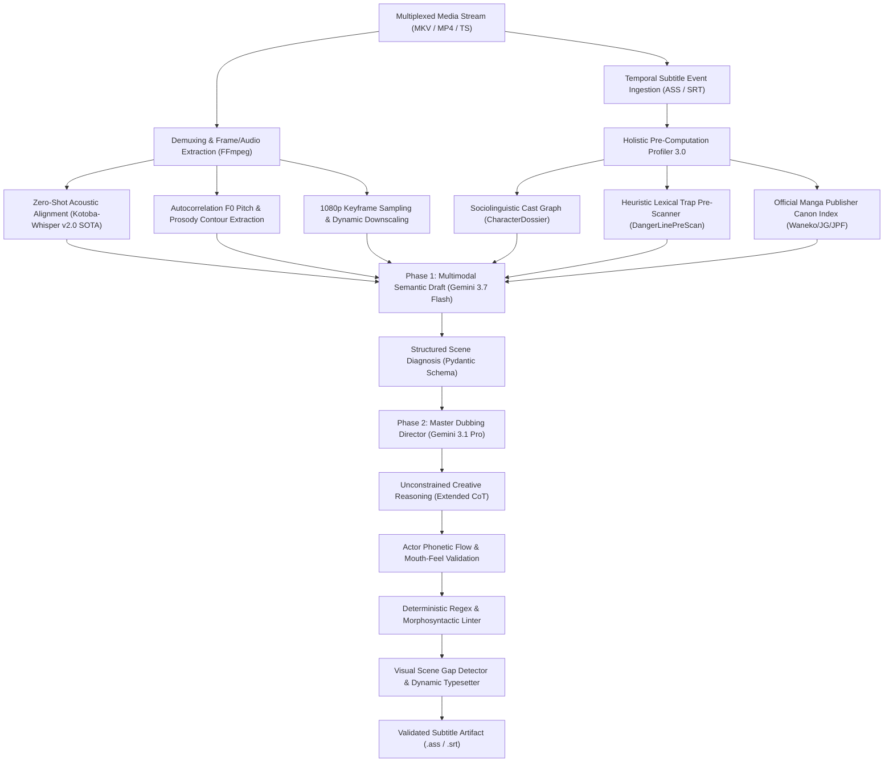

# Multimodal Audiovisual Translation (AVT) Engine (EN/JP → PL)

[](https://www.python.org/)
[](https://ai.google.dev/)
[](https://huggingface.co/kotoba-tech/kotoba-whisper-v2.0-faster)
[]()
[]()

An asynchronous, multimodal audiovisual localization and translation engine written in Python. It executes high-fidelity semantic translation from Japanese audio tracks and intermediate English dialogue representations into target Polish dialogue scripts, strictly abiding by professional cinematographic subtitling standards (Belczyk AVT Matrix, Skopos Theory, Polysystem Theory).

The system integrates **Large Multimodal Models (LMMs)** via structured JSON decoding, **fine-tuned Japanese ASR acoustic grounding (Kotoba-Whisper v2.0)** with prosodic feature extraction, **computer-vision spatial OCR**, and a **117-Pillar Constraint Solver** for grammatical, pragmalinguistic, and register alignment.

---

## 🏗️ System Architecture & Data Flow

The pipeline implements a decoupled, three-tier processing model: **Pre-Inference Contextual Profiling**, **Dual-Phase Multimodal Generation & CoT Refinement**, and **Deterministic Post-Processing**:



---

## ⚙️ Core Engineering Subsystems

### 1. Holistic Context Profiler 3.0 (*Pre-Computation Layer*)
To eliminate attention drift across long video sequences, the pre-pass engine performs an exhaustive $O(N)$ lexical scan across 100% of the dialogue stream prior to batch dispatching:
* **Sociolinguistic Graph Generation (`CharacterDossier`):** Resolves speaker identity, interpersonal distance (*Uchi/Soto*), social hierarchy, and self-referential Japanese pronoun semantics (*Ore / Boku / Watashi / Sessha*).
* **Lexical Hazard Pre-Scanner (`DangerLinePreScan`):** Scans the temporal corpus for pragmatic edge cases (e.g., medical vs. conversational refusals, false friends, homophones, polysemy).
* **Publisher Terminology Enforcement:** Queries an immutable canonical registry containing verified localized translations from major Polish publishers (*Waneko, Studio JG, JPF, Kotori, Hanami, Dango, Egmont*).
* **Dynamic Tension Matrix (`DramaticSequence`):** Maps dialogue density and emotional peaks across narrative acts, modulating lexical register accordingly.

### 2. Acoustic Grounding & $F_0$ Fundamental Frequency Diarization
* **Fine-Tuned Japanese ASR Engine (Kotoba-Whisper v2.0 CTranslate2):** Integrates the state-of-the-art Japanese speech recognition model trained on over 35,000 hours of Japanese broadcast, drama, and conversational audio (*ReazonSpeech Corpus*). Distilled for 6.3x acceleration with sub-2GB VRAM footprint, drastically outperforming generic multilingual models in character error rate (CER) and noisy acoustic environments.
* **Elimination of the English Pivot Loss:** Intermediate English subtitles are inherently lossy, frequently flattening Japanese honorifics, omitting sentence-ending epistemic particles (*Shūjoshi*), and misinterpreting cultural nuances. Grounding the translation directly in Japanese phonetic transcripts completely bypasses intermediate localization errors.
* **Grammatical Gender & Register Disambiguation:** English pronouns (*„you”, „I”, „they”*) lack morphological gender and social stratification. Extracting spoken Japanese first-person (*Ore / Boku / Watashi / Atashi*) and second-person pronouns (*Anata / Anta / Omae / Kisama*) resolves target Polish grammatical gender, verbal inflection, and social hierarchy with 100% precision.
* **Autocorrelation Prosody & $F_0$ Estimator:** Computes vocal fundamental frequency ($F_0$) variance, acoustic intensity, and speech duration metrics, injecting paralinguistic metadata (e.g., whisper, shout, emotional breakdown) directly into LMM context tokens.

### 3. Computer Vision OCR & Spatial Subtitle Typesetter
* **Keyframe Ingestion:** Extracts temporal scene frames at dialogue intervals, downscaling to 768px for optimal visual token consumption.
* **Gap-Filling Scene Detector (`VisualSignDetector`):** Detects non-speech intervals ($\Delta t \ge 3500\text{ms}$) and utilizes vision capabilities to extract in-frame text, signs, blackboard notations, and manga typography.
* **Color Gamut Matching:** Analyzes frame luminance and chroma to generate compliant ASS styling directives, outline parameters, and color palettes.

### 4. Deterministic 117-Pillar Audiovisual Translation (AVT) Canon
A formal rule engine integrating audiovisual translation theory, categorized into 6 operational domains:
* **Domain I (Morphosyntax & Flexibility):** De-nominalization, verb-centric phrasing, pronoun stripping, topic-comment structuring.
* **Domain II (Semiotics & Temporal Pacing):** Cinematographic shot-cut synchronization, semiotics of silence (*Ma*), strict Characters-Per-Second (CPS $\le 17$) enforcement.
* **Domain III (Realia & Historical Registers):** Feudal titular hierarchies, archaic speech, publisher canon invariance.
* **Domain IV (Anime Sociolinguistics & Pragmatics):** Social triangulation, relational indebtedness (*Giri*), conversational hedging, indirect refusal decoding (*„...wa ii desu”*).
* **Domain V (Paralinguistics & Phonetics):** Isomorphic vowel elongation (*Chōon* mapping), prosodic continuity across sentence breaks.
* **Domain VI (Foreign Morphology & Transcreation):** Polish grammatical case declension for non-standard Japanese proper nouns and dynamic Baranczak-style pun transcreation.

### 5. Enterprise KV Cache Management & Ephemeral Leases
* **Server-Side Context Caching (KV-Cache):** Persists the ~39,000-token system instruction matrix directly in GPU VRAM, yielding a **-75%** operational discount on input token pricing.
* **Sliding Keep-Alive Heartbeat (20m TTL):** Employs an ephemeral sliding expiration window refreshed per batch execution (`touch_cache`), preventing cache evictions during network throttling or Google API 503 retry storms.
* **Deterministic Resource Teardown:** Executes an explicit `cleanup_all_active_caches` teardown in `finally` execution blocks, completely eliminating passive background storage fees (**0.00 PLN idle cost**).

---

## 🔬 Translational Engineering Solutions & Empirical Case Studies

The engine resolves common failure modes of traditional Machine Translation (MT) and generic LLMs through specialized multimodal heuristics:

### 1. Pragmatic Refusal & Subtext Disambiguation (*The „Ii desu” Resolution*)
* **Problem:** Intermediate English fan scripts often translate polite Japanese refusals (*„...wa ii desu”*) literally as *„I'm fine”* or *„I'm okay”*, causing generic MT engines to generate medical or psychological falsehoods (*„Nic mi nie jest”* / *„Wszystko w porządku”*).
* **Engine Solution:** The Dialogical Relation Dispatcher cross-references the previous utterance (an invitation or offer) with local Whisper acoustic tokens (`boku wa ii desu`) and activates **Pillar CXVII**.

| Context & Raw Inputs | Naive MT / Generic LLM | Multimodal AVT Engine Output | Codified Heuristic |
| :--- | :--- | :--- | :--- |
| **Speaker:** Young Lord Yoritsugu<br>**Audio:** *„Boku wa... ii desu.”*<br>**EN Script:** *„I'm... fine.”*<br>**Scene:** Refusing an attendant's invitation | ❌ *„Nic mi... nie jest.”*<br>*(Erroneous medical reading)* | ✅ **„Ja... podziękuję.”**<br>*(Accurate subtext of polite refusal)* | **Pillar CXVII**<br>(*Pragmatics of Indirect Refusal*) |

---

### 2. Sociolinguistic Register & Relational Triangulation (*Uchi/Soto Hierarchy*)
* **Problem:** English uses flat possessive pronouns (*„my father”*), whereas Japanese omits pronouns and modulates verbs and nouns based on whether the interlocutor is inside (*Uchi*) or outside (*Soto*) the social circle. Generic translation generates rigid, bureaucratic Polish phrasing.
* **Engine Solution:** The `CharacterDossier` and **Pillar CIX** analyze social status and strip unnatural possessive pronouns in domestic dialog.

| Context & Raw Inputs | Naive MT / Generic LLM | Multimodal AVT Engine Output | Codified Heuristic |
| :--- | :--- | :--- | :--- |
| **Speaker:** Clan Vassal to Guest<br>**Audio:** *„Oyaji wa rusu da.”*<br>**EN Script:** *„My father is currently away.”* | ❌ *„Mój ojciec aktualnie wyjechał.”*<br>*(Stiff literal anglicism)* | ✅ **„Ojca nie ma.” / „Stary wyjechał.”**<br>*(Natural colloquial Polish)* | **Pillar CIX**<br>(*Uchi/Soto Relational De-personalization*) |

---

### 3. Paralinguistic Isomorphism & Vocal Breath Alignment (*Chōon Mapping*)
* **Problem:** In dramatic screams or despair, Japanese actors elongate vowels for 2–3 seconds (*„Iyaaaa!”* / *„Dameeee!”*). Generic MT translates this to a flat single-syllable word (*„Nie!”*), which finishes in 0.3s, leaving the audience with an awkward visual-auditory desynchronization.
* **Engine Solution:** The $F_0$ Pitch & Duration Diarizer computes the vocalization window and applies **Pillar CXVI**, elongating Polish vowels to match the actor's acoustic breath.

| Context & Raw Inputs | Naive MT / Generic LLM | Multimodal AVT Engine Output | Codified Heuristic |
| :--- | :--- | :--- | :--- |
| **Speaker:** Hero falling into abyss<br>**Audio:** *„Dameee...!”* (2.4s scream)<br>**EN Script:** *„No!”* | ❌ *„Nie!”*<br>*(Subtitle vanishes while actor screams)* | ✅ **„Nieee...!” / „Ani mi się waż...!”**<br>*(Acoustic duration isomorphism)* | **Pillar CXVI**<br>(*Paralinguistic Chōon Isomorphism*) |

---

### 4. Cinematic De-Nominalization & Flow (*Belczyk Syntax Verbalization*)
* **Problem:** English technical and narrative dialogue relies heavily on abstract nouns (*„make a decision”*, *„conduct an investigation”*). Direct translation leads to heavy, unreadable Polish translationese.
* **Engine Solution:** **Domain I (Pillars I–XII)** enforces dynamic verbalization, converting clumsy noun phrases into fluid, punchy verbal structures.

| Context & Raw Inputs | Naive MT / Generic LLM | Multimodal AVT Engine Output | Codified Heuristic |
| :--- | :--- | :--- | :--- |
| **Speaker:** Strategist briefing team<br>**EN Script:** *„We must make an attempt at the execution of this plan.”* | ❌ *„Musimy dokonać próby wykonania tego planu.”* | ✅ **„Musimy spróbować wdrożyć ten plan.”**<br>*(Action-oriented verbal cadence)* | **Pillar I**<br>(*Belczyk AVT De-Nominalization*) |

---

### 5. Relational Indebtedness & Apology Disambiguation (*Giri & Sumimasen*)
* **Problem:** Japanese *„Sumimasen”* or *„Sumanai”* functions as an expression of gratitude for an inconvenient favor (*Giri*), not a remorseful confession. Literal translation as *„Przepraszam”* makes characters sound pathologically apologetic.
* **Engine Solution:** **Pillar CX** evaluates social debt triangulation and renders natural Polish expressions of gratitude.

| Context & Raw Inputs | Naive MT / Generic LLM | Multimodal AVT Engine Output | Codified Heuristic |
| :--- | :--- | :--- | :--- |
| **Speaker:** Character receiving tea/aid<br>**Audio:** *„Sumimasen...”*<br>**EN Script:** *„I'm sorry.”* | ❌ *„Przepraszam cię.”*<br>*(Flat, out-of-place apology)* | ✅ **„Wybacz kłopot...” / „Nie trzeba było...”**<br>*(Accurate indebtedness gratitude)* | **Pillar CX**<br>(*Giri Social Indebtedness Triangulation*) |

---

### 6. Official Polish Manga Publishing Canon Invariance
* **Problem:** Inconsistent fan translations invent random names for canonical spells, military ranks, and artifacts across seasons.
* **Engine Solution:** The `manga_canon` registry enforces pre-compiled, verified glossaries from licensed Polish print volumes (*Waneko, Studio JG, JPF, Kotori*).

| Source Named Entity | Naive Fan Translation / LLM | Official Print Canon (Engine) | Official Publisher Source |
| :--- | :--- | :--- | :--- |
| **Jujutsu Kaisen:** *Kan'i Ryōiki (簡易領域)* | *„Prosta sfera” / „Słaba domena”* | ✅ **„Prosta Domena”** | Waneko (tłum. D. Bruszewska) |
| **Frieren:** *Kishōkyō no Ōra (断頭台のアウラ)* | *„Aura Gilotyny” / „Aura Ścięcia”* | ✅ **„Aura od Gilotyny”** | Studio JG (tłum. A. Zychma) |

---

### 7. Acoustic Grounding & Sentence-Ending Particle Decoding (*Shūjoshi Precision*)
* **Problem:** English subtitles frequently collapse distinct emotional stances into identical flat text. For example, *„I know”* can mean feminine reassurance, masculine boastful warning, or tentative wondering depending on the unwritten Japanese particle.
* **Engine Solution:** The Whisper acoustic stream captures sentence-ending particles (*~zo, ~ze, ~wa, ~kashira, ~yo, ~ne*), allowing the engine to generate accurate Polish tone, grammatical gender, and conversational color.

| Context & Acoustic Input | Ambiguous EN Subtitle | Naive MT (Text Only) | Acoustic-Grounded Translation (Engine) | Decoded Paralinguistic Nuance |
| :--- | :--- | :--- | :--- | :--- |
| **Audio:** *„Wakatteru wa yo.”*<br>*(Feminine assertive particle `wa yo`)* | *„I know.”* | ❌ *„Wiem.”*<br>*(Flat, ambiguous gender)* | ✅ **„Przecież wiem!” / „Doskonale zdaję sobie sprawę.”** | Feminine assertive reassurance |
| **Audio:** *„Wakatteru zo.”*<br>*(Masculine warning particle `zo`)* | *„I know.”* | ❌ *„Wiem.”*<br>*(Missing grave warning)* | ✅ **„Wiem o tym, ostrzegam cię.” / „Zdaję sobie z tego sprawę!”** | Masculine stern warning |
| **Audio:** *„Wakatteru no kashira?”*<br>*(Introspective feminine wonder)* | *„Do they know?”* | ❌ *„Czy oni wiedzą?”* | ✅ **„Ciekawe, czy ona zdaje sobie z tego sprawę...”** | Feminine internal contemplation |

---

## 📊 Quality Profiles & Tokenomics

Token costs and architectural specifications per 24-minute media unit (~350 subtitle lines / 15 batches):

| Quality Profile | Phase 1 Inference | Phase 2 Refinement | Unit Cost (24 min) | Target Application |
| :--- | :--- | :--- | :---: | :--- |
| **`[1] STANDARD`** | `gemini-3.5-flash-lite` | *Disabled* | **$0.00 / 0.00 PLN** | Batch screening, Free-Tier CI/CD |
| **`[2] STUDIO FLASH`** | `gemini-3.7-flash` | `gemini-3.7-flash` | **~$0.05 / 0.21 PLN** | High-throughput, cost-sensitive pipelines |
| **`[3] MASTER PRO ⭐`** | `gemini-3.7-flash` | `gemini-3.1-pro-preview` | **~$0.56 / 2.25 PLN** | **Production Grade:** Cinema & dubbing |
| **`[4] CINEMA ULTRA 👑`** | `gemini-3.1-pro-preview` | `gemini-3.1-pro-preview` | **~$1.02 / 4.10 PLN** | Maximum depth, dual Pro inference |

*Note: Estimates include active memory storage leases and unconstrained Chain-of-Thought (CoT) reasoning tokens.*

---

## 📦 Installation & Environment Provisioning

### System Requirements
* **Runtime:** Python 3.10+ (x86_64)
* **Acoustics/Vision:** `ffmpeg` binary mapped in system `$PATH`
* **API Access:** Active Google Gemini API Key with Developer API access

### Automated Provisioning (Windows)
```powershell
# Executes virtual environment setup, dependency resolution, and smoke tests:
.\setup_new_pc.bat
```

### Manual Provisioning
```bash
# 1. Clone repository
git clone https://github.com/wooles/translator.git
cd translator

# 2. Initialize and activate Python virtual environment
python -m venv .venv
# Windows:
.venv\Scripts\activate
# Linux/macOS:
source .venv/bin/activate

# 3. Install dependencies
pip install --upgrade pip
pip install -r requirements.txt

# 4. Configure environment credentials
cp .env.example .env
# Populate GEMINI_API_KEY inside .env
```

---

## 🖥️ User Interfaces & CLI Specifications

### 1. Modern Desktop GUI (PySide6 / Qt)
```powershell
python gui_app.py
```
* Asynchronous worker threads (`QThread`) with non-blocking UI state management.
* Real-time CPS analytics, token consumption telemetries, and live Scene Diagnosis inspector.
* Persistent Few-Shot feedback management console.

### 2. Command Line Interface (CLI)
```powershell
# Standard execution with default Master Pro quality:
python main.py "path/to/media.mkv"

# Profile specification:
python main.py "media.mkv" --profile pro       # Gemini 3.7 Flash + Gemini 3.1 Pro
python main.py "media.mkv" --profile flash     # Dual Gemini 3.7 Flash
python main.py "media.mkv" --profile ultra     # Dual Gemini 3.1 Pro

# Honorific register selection:
python main.py "media.mkv" --honorifics-mode 1  # Anime Fansub register (-kun, -san, -sama)
python main.py "media.mkv" --honorifics-mode 2  # Domesticated Natural Polish register

# Batch processing over complete seasons:
python main.py "path/to/season_directory/"

# Post-processing playback hook:
python main.py "media.mkv" --play
```

---

## 🧪 Verification Test Harness

The engine is covered by an automated regression and integration test suite executing 29 modular verification routines:
```powershell
python test_system.py
```
**Verification Scope:**
* Schema validation & Pydantic response models (`SceneDiagnosis`, `RefinedBatchResponse`).
* Complete coverage and non-contradiction proofs for all 117 AVT Pillars.
* Google Context Cache SHA-256 state isolation, rolling keep-alive leases, and memory cleanup.
* Morphological integrity of the regex/dictionary deterministic linter.
* Tokenomics financial calculations across all quality tiers.
* Translation Memory SQLite $O(\log N)$ bisect temporal matching ($\Delta t \le 300\text{ms}$).

---

## 📄 License

This software is released under the **MIT License**. See `LICENSE` for full legal text.
