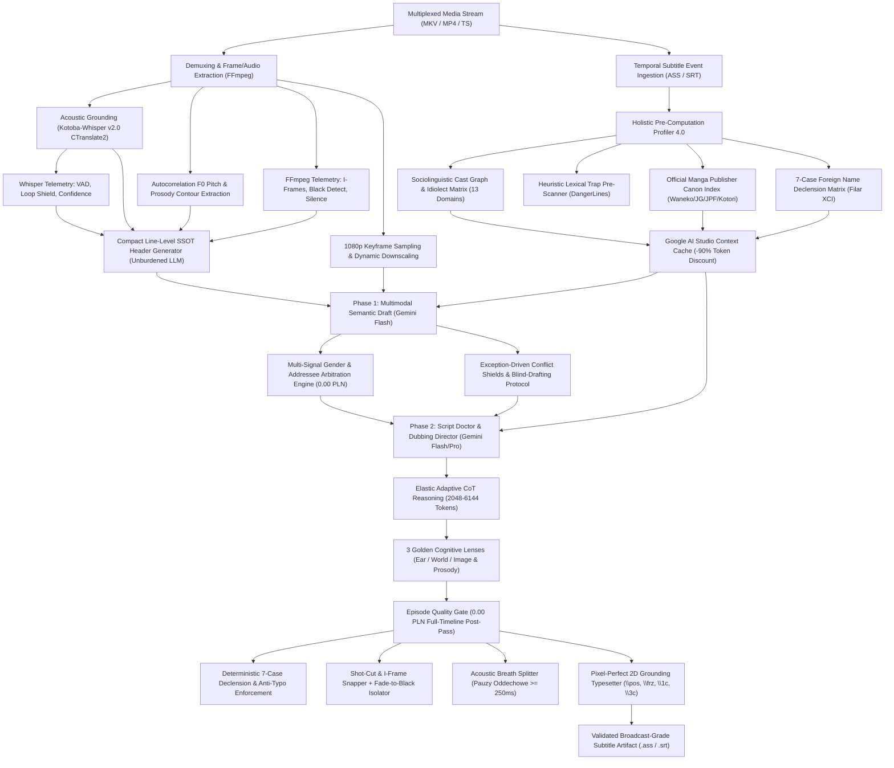

# Multimodal Audiovisual Translation (AVT) Engine (EN/JP → PL)

[](https://www.python.org/)
[](https://ai.google.dev/)
[](https://huggingface.co/kotoba-tech/kotoba-whisper-v2.0-faster)
[]()
[]()
[](LICENSE)

An asynchronous, multimodal audiovisual translation and localization engine engineered in Python. It executes high-fidelity semantic translation from Japanese audio streams, video keyframes, and intermediate dialogue representations into target Polish dialogue scripts, strictly adhering to cinematographic subtitling standards (Belczyk AVT Matrix, Skopos Theory, Polysystem Theory, and Netflix AVT Timed Text Guidelines).

The engine integrates **Large Multimodal Models (LMMs)** via structured schema decoding, **fine-tuned Japanese ASR acoustic grounding (Kotoba-Whisper v2.0 CTranslate2)** with $F_0$ fundamental frequency pitch and prosodic contour extraction, **FFmpeg temporal and visual telemetry** (I-frame snapping, Fade to Black boundary isolation, native silence detection), **computer-vision spatial OCR & Pixel-Perfect Typesetting (Grounding 2D)**, a **176-Pillar AVT Constraint Solver**, **Profiler 4.0 Pre-Computation**, **Cross-Episode Series Memory (SQLite FTS5 BM25)** with a **7-Case Foreign Name Declension Matrix**, and an **Episode Quality Gate (0.00 PLN)** offline post-processing safety net.

---

## 🏗️ System Architecture & Data Flow

The pipeline implements an end-to-end, decoupled architecture: **Pre-Inference Contextual Profiling (Profiler 4.0)**, **Server-Side KV Context Caching (-90% discount)**, **Dual-Phase Multimodal Inference with Elastic Adaptive CoT**, **Exception-Driven Conflict Shields**, and a **Deterministic Post-Pass (0.00 PLN Episode Quality Gate)**:



---

## ⚙️ Core Engineering Subsystems

### 1. Holistic Context Profiler 4.0 (*Pre-Computation Layer*)
To eliminate attention drift across long video sequences, the pre-pass engine performs an exhaustive lexical and contextual scan across 100% of the episode script prior to batch translation (cached locally in `.profile.json`, single zero-budget API call):
* **13 Structured Analytical Domains:** Encompasses publisher manga canon, era & physical environment setting, specialized domain vocabulary, danger lines prescan, relationship dynamic pivots, frozen character catchphrases, Stanisław Barańczak syllabic song transcreation, Japanese *Dajare* pun adaptations, cross-episode continuity bridges, chronological dramatic sequences, cast idiolect dossiers, 7-case name declensions, and *Yojijukugo* idioms.
* **Relationship Dynamic Pivots (`RelationshipPivot`):** Detects psychological turning points in dialogue where characters switch forms of address (e.g. from formal *Pan/Pani* to informal *ty*), freezing the exact timestamp to prevent regression in subsequent episodes.
* **7-Case Foreign Name Declension Matrix (Filar XCI):** Automatically generates the full 7-case grammatical inflection table for fantasy and foreign proper nouns (e.g. *Drel → Drela / Drelowi / Drela / Drelem / Drelu / Drelu*), eliminating uninflected possessive anglicisms (*"sekretów Drel"* ❌ → *"sekretów Drela"* ✅).

### 2. Acoustic Grounding & Whisper Telemetry Subsystem (Kotoba-Whisper v2.0)
* **Fine-Tuned Japanese ASR Engine (Kotoba-Whisper v2.0 CTranslate2):** Integrates the state-of-the-art Japanese speech recognition model trained on 35,000+ hours of Japanese broadcast audio (*ReazonSpeech Corpus*). Accelerated for sub-2GB VRAM inference, drastically outperforming generic multilingual models in character error rate (CER), homophone disambiguation (Kanji context priors), and noisy acoustic environments.
* **Whisper Anti-Hallucination Loop Shield (`detect_hallucination_loop`):** Intercepts repetitive phrase degenerations and abnormal compression ratios (`compression_ratio > 2.4` or $N$-gram loops), isolating genuine audio transcripts from phantom ASR feedback loops.
* **Voice Activity Filter (`filter_voice_activity`):** Evaluates `no_speech_prob` ($\ge 0.85$), identifying background music, battle soundscapes, and silent video sections to eliminate phantom subtitle lines.
* **Acoustic Confidence Metric (`assess_acoustic_confidence`):** Evaluates `avg_logprob` to categorize acoustic clarity (`HIGH` vs `LOW`), alerting downstream engines to muffled voices or screams.
* **Autocorrelation Prosody & $F_0$ Estimator:** Computes fundamental frequency ($F_0$) contours, acoustic intensity (RMS dBFS), and speech duration metrics, injecting paralinguistic metadata (whisper, shout, emotional tremor) directly into LMM context tokens.

### 3. FFmpeg Temporal & Visual Telemetry Subsystem
* **Shot-Cut Snapping (Netflix AVT Standard):** Automatically detects shot cuts within 2 frames ($\le 84\text{ms}$) and snaps subtitle boundaries to prevent flash-frames and visual bleeding across cuts.
* **Keyframe (I-Frame) Snapping (`detect_keyframes_ffmpeg`):** Detects exact I-frames using native FFmpeg packet analysis, snapping dialogue starts to preceding keyframes within a 120ms window for clean visual render entry.
* **Fade to Black Detection (`detect_black_frames_ffmpeg`):** Utilizes native `blackdetect` filters to identify true scene blackouts, isolating dialogue pacing and resetting conversational momentum.
* **Native Silence Detection (`detect_silence_ffmpeg`):** Analyzes decibel drop thresholds (`silencedetect=n=-35dB:d=0.25`) to identify inter-sentence pauses.

### 4. Acoustic Breath Splitter (`split_subtitle_at_acoustic_pause`)
* **Natural AVT Line Breaks:** Long subtitle events ($> 38$ characters) are split at the exact millisecond of acoustic silence ($\ge 250\text{ms}$) detected by FFmpeg and Whisper. This guarantees that visual line transitions match the actor's inhalation, maintaining rhythm and reading comfort.

### 5. Multi-Signal Gender & Addressee Arbitration Engine (0.00 PLN)
* **Gender Hallucination Neutralization:** Triangulates character registry metadata, Whisper Japanese grammatical cues (*ore/boku/watashi/atashi/sessha*), and local $F_0$ voice pitch estimation to arbitrate speaker gender deterministically before Phase 2.
* **Multimodal Addressee Resolution (Filar CLXIII):**
  * **2nd-Person Singular Address (*ty*):** Distinguishes whether the single addressee in 1-on-1 dialogue is female (`kobieta` → *-łaś, byłaś, jesteś pewna, gotowa*) or male (`mężczyzna` → *-łeś, byłeś, jesteś pewien, gotowy*).
  * **2nd-Person Plural Group Address (*wy*):** Distinguishes female groups (`grupa_kobiet` → *-łyście, byłyście gotowe*) from male/mixed groups (`grupa_mężczyzn/grupa_mieszana` → *-liście, byliście gotowi*), cross-referenced with Whisper plural markers (*-tachi, omae-ra, minna, shokun*).
* **1st-Person Plural Feminine Group Concordance (Filar CLXXV):** In scenes where characters present are exclusively female, past tense, conditional, adjectival, and numeral 1st-person plural forms (*my*) are deterministically harmonized to non-virile Polish grammar (*-łyśmy*, *-łybyśmy*, *my obie*, *byłyśmy gotowe*), preventing masculine leakage.
* **Speaker Entity Identity & Collective Concordance Shield (Filar CLXXVI):** Isolates speaker entity types (`COLLECTIVE_VIRILE`, `MAJESTIC_FEMALE`, `INDIVIDUAL`). Shields multi-entity characters manifesting as a single speaker (e.g. *Louis Arneb* representing the masculine/mixed Gluttony Trinity in *Re:Zero S4*) from erroneous feminization in female-only duels, and enforces non-virile *Pluralis Maiestatis* for female monarchs in mixed courts.

### 6. Dynamic Attention Dispatcher & LLM Unburdening
* **Dynamic Attention Spotlight (`get_focused_rules_for_batch`):** Out of 176+ codified pillars, dynamically selects **at most 3 high-priority pillars** per batch based on real-time scene parameters (CPS speed, interrogatives, typesetting, group address).
* **Tier 10 Offloading:** Mechanical grammatical rules (such as plural agreement and collective concordances) are offloaded to low-priority background tiers (Tier 10) and positive craft priming, keeping Gemini attention unburdened and reserving token capacity for AVT dialogue transcreation.
* **Compact Line-Level SSOT Header (`format_compact_ssot_tag`):** Replaces verbose instructions with a single standardized metadata string (`[SSOT: Spk=... G=... Addr=... Ac=...]`), freeing model attention and eliminating prompt bloat.

### 7. Exception-Driven Architecture & Conflict Shields
* **Blind-Drafting Protocol:** When a severe acoustic or pragmatic mismatch is detected between the English fan script and Japanese audio keywords (*hitori, betsuni, yokatta, yatta*), the Phase 1 candidate is blinded from the Phase 2 prompt (`is_blind_draft=True`), forcing the Script Doctor to translate autonomously from raw audio and source text without anchoring bias.
* **Acoustic Primacy Veto (Filar CLXXIV):** Overrules corrupted fansub speaker tags (*Ögedei* attributed to a line spoken by a female seiyū in a tent) in favor of the acoustic ground-truth and scene context.
* **Thought-to-Speech Firewall:** Enforces strict styling separation between internal character thoughts (italicized `{\i1}`) and diegetic spoken dialogue.
* **T-V Invariance & Honorific Vocative Shield (Filar CLVII):** Prevents formal address contamination (*Pan/Pani*) in intimate scenes where characters converse on first-name informal terms (*ty*).
* **Typo Shield & Lexical Integrity (Filar CLXIV):** Enforces 100% lexical hygiene, eliminating keyboard artifacts and non-existent phonetic distortions (*„spyham”* ❌ → *„spytam”* ✅, *„wziąść”* ❌ → *„wziąć”* ✅).

### 8. Deterministic 176-Pillar AVT Canon
A comprehensive constraint solver implementing cinematographic subtitling theory across 7 major domains:
* **Domain I (Morphosyntax & Flexibility):** De-nominalization, verb-centric phrasing, pronoun stripping, topic-comment structuring.
* **Domain II (Semiotics & Temporal Pacing):** Cinematographic shot-cut synchronization, semiotics of silence (*Ma*), strict Characters-Per-Second (CPS $\le 17$) enforcement.
* **Domain III (Realia & Historical Registers):** Feudal titular hierarchies, archaic speech, publisher canon invariance.
* **Domain IV (Anime Sociolinguistics & Pragmatics):** Social triangulation, relational indebtedness (*Giri*), conversational hedging, indirect refusal decoding (*„...wa ii desu”*).
* **Domain V (Paralinguistics & Phonetics):** Isomorphic vowel elongation (*Chōon* mapping), prosodic continuity across sentence breaks.
* **Domain VI (Transcreation, Idiolects & Song Metre):** Polish 7-case noun declension, Stanisław Barańczak syllabic song/rhyme transcreation (**Pillar CXVIII**), Character Idiolect Matrix (**Pillar CXIX**), and Blind Native Polish Critic fluency validation.
* **Domain VII (Temporal Discontinuity, Acoustic Primacy & Collective Entities):** Spatiotemporal shifts, anti-pivot cliches, acoustic primacy over contaminated fansub metadata (**Pillar CLXXIV**), 1st-person plural feminine group concordance (**Pillar CLXXV**), and speaker entity identity / collective concordance shields (**Pillar CLXXVI**).

### 9. 4-Tier Authority Glossary Hierarchy
Terminology is resolved deterministically through a strict 4-tier hierarchy:
1. **Tier 1 (Highest): Official Polish Manga Publishing Canon** (*Waneko, Studio JG, J.P.Fantastica, Kotori, Hanami, Dango, Egmont*).
2. **Tier 2: Cross-Episode Series Bible** (Persistent across full seasons, SQLite FTS5 BM25 search).
3. **Tier 3: Episode Profiler 4.0** (Episodic context and entity discovery).
4. **Tier 4 (Fallback): User Glossary** (Custom user overrides).

### 10. Enterprise Context Caching (-90% Token Cost) & Multi-Key Pool
* **Server-Side KV Context Caching:** Persists the entire episode knowledge matrix (Profiler, Series Bible, 4-Tier Glossary, Few-Shot Rules) directly in GPU VRAM on Google AI Studio, slashing input token billing by **-90%**.
* **Pre-Warming & Hard Cost Lock:** Guarantees `ensure_cache_ready` across all models before dispatching batches. Blocks execution safely if caching fails, protecting user budgets against full-rate charges.
* **Sliding Keep-Alive Heartbeat (20m TTL):** Refreshes cache leases dynamically per batch, preventing eviction during API backoff delays.
* **Multi-Key Client Pool with Zero-Wait Hopping:** Cycles requests smoothly across multiple Gemini API keys with 200ms micro-pauses, neutralizing rate-limit bottlenecks.

### 11. Episode Quality Gate (0.00 PLN Full-Timeline Post-Pass)
Operates on the entire `.ass` subtitle timeline after translation completes, executing deterministic corrections at zero extra API cost:
* Complete enforcement of the 4-tier glossary and 7-case foreign name declensions (Filar XCI).
* 2nd-person singular and plural addressee verb and adjective gender agreement (Filar CLXIII).
* Automatic correction of keyboard typos and malformed verbs (Filar CLXIV).
* Shot-cut and I-frame boundary snapping.
* Acoustic breath line splitting for events $\ge 38$ characters.
* Syntax-aware line breaking (max 42 characters per line) and CPS speed regulation.
* ASS tag sanitization and typography consistency.

---

## 🔬 Translational Engineering Solutions & Empirical Case Studies

The engine resolves common failure modes of traditional Machine Translation (MT) and generic LLMs through specialized multimodal heuristics:

### 1. Pragmatic Refusal & Subtext Disambiguation (*The „Ii desu” Resolution*)
* **Problem:** Intermediate English fan scripts often translate polite Japanese refusals (*„...wa ii desu”*) literally as *„I'm fine”* or *„I'm okay”*, causing generic MT engines to generate medical or psychological falsehoods (*„Nic mi nie jest”* / *„Wszystko w porządku”*).
* **Engine Solution:** The Dialogical Relation Dispatcher cross-references the previous utterance (an invitation or offer) with local Whisper acoustic tokens (`boku wa ii desu`) and activates **Pillar CXVII**.

| Context & Raw Inputs | Naive MT / Generic LLM | Multimodal AVT Engine Output | Codified Heuristic |
| :--- | :--- | :--- | :--- |
| **Speaker:** Young Lord Yoritsugu<br>**Audio:** *„Boku wa... ii desu.”*<br>**EN Script:** *„I'm... fine.”*<br>**Scene:** Refusing an attendant's invitation | ❌ *„Nic mi... nie jest.”*<br>*(Erroneous medical reading)* | ✅ **„Ja... podziękuję.”**<br>*(Accurate subtext of polite refusal)* | **Pillar CXVII**<br>(*Pragmatics of Indirect Refusal*) |

---

### 2. Sociolinguistic Register & Relational Triangulation (*Uchi/Soto Hierarchy*)
* **Problem:** English uses flat possessive pronouns (*„my father”*), whereas Japanese omits pronouns and modulates verbs and nouns based on whether the interlocutor is inside (*Uchi*) or outside (*Soto*) the social circle. Generic translation generates rigid, bureaucratic Polish phrasing.
* **Engine Solution:** The `CharacterDossier` and **Pillar CIX** analyze social status and strip unnatural possessive pronouns in domestic dialog.

| Context & Raw Inputs | Naive MT / Generic LLM | Multimodal AVT Engine Output | Codified Heuristic |
| :--- | :--- | :--- | :--- |
| **Speaker:** Clan Vassal to Guest<br>**Audio:** *„Oyaji wa rusu da.”*<br>**EN Script:** *„My father is currently away.”* | ❌ *„Mój ojciec aktualnie wyjechał.”*<br>*(Stiff literal anglicism)* | ✅ **„Ojca nie ma.” / „Stary wyjechał.”**<br>*(Natural colloquial Polish)* | **Pillar CIX**<br>(*Uchi/Soto Relational De-personalization*) |

---

### 3. Paralinguistic Isomorphism & Vocal Breath Alignment (*Chōon Mapping*)
* **Problem:** In dramatic screams or despair, Japanese actors elongate vowels for 2–3 seconds (*„Iyaaaa!”* / *„Dameeee!”*). Generic MT translates this to a flat single-syllable word (*„Nie!”*), which finishes in 0.3s, leaving the audience with an awkward visual-auditory desynchronization.
* **Engine Solution:** The $F_0$ Pitch & Duration Diarizer computes the vocalization window and applies **Pillar CXVI**, elongating Polish vowels to match the actor's acoustic breath.

| Context & Raw Inputs | Naive MT / Generic LLM | Multimodal AVT Engine Output | Codified Heuristic |
| :--- | :--- | :--- | :--- |
| **Speaker:** Hero falling into abyss<br>**Audio:** *„Dameee...!”* (2.4s scream)<br>**EN Script:** *„No!”* | ❌ *„Nie!”*<br>*(Subtitle vanishes while actor screams)* | ✅ **„Nieee...!” / „Ani mi się waż...!”**<br>*(Acoustic duration isomorphism)* | **Pillar CXVI**<br>(*Paralinguistic Chōon Isomorphism*) |

---

### 4. Cinematic De-Nominalization & Flow (*Belczyk Syntax Verbalization*)
* **Problem:** English technical and narrative dialogue relies heavily on abstract nouns (*„make a decision”*, *„conduct an investigation”*). Direct translation leads to heavy, unreadable Polish translationese.
* **Engine Solution:** **Domain I (Pillars I–XII)** enforces dynamic verbalization, converting clumsy noun phrases into fluid, punchy verbal structures.

| Context & Raw Inputs | Naive MT / Generic LLM | Multimodal AVT Engine Output | Codified Heuristic |
| :--- | :--- | :--- | :--- |
| **Speaker:** Strategist briefing team<br>**EN Script:** *„We must make an attempt at the execution of this plan.”* | ❌ *„Musimy dokonać próby wykonania tego planu.”* | ✅ **„Musimy spróbować wdrożyć ten plan.”**<br>*(Action-oriented verbal cadence)* | **Pillar I**<br>(*Belczyk AVT De-Nominalization*) |

---

### 5. Relational Indebtedness & Apology Disambiguation (*Giri & Sumimasen*)
* **Problem:** Japanese *„Sumimasen”* or *„Sumanai”* functions as an expression of gratitude for an inconvenient favor (*Giri*), not a remorseful confession. Literal translation as *„Przepraszam”* makes characters sound pathologically apologetic.
* **Engine Solution:** **Pillar CX** evaluates social debt triangulation and renders natural Polish expressions of gratitude.

| Context & Raw Inputs | Naive MT / Generic LLM | Multimodal AVT Engine Output | Codified Heuristic |
| :--- | :--- | :--- | :--- |
| **Speaker:** Character receiving tea/aid<br>**Audio:** *„Sumimasen...”*<br>**EN Script:** *„I'm sorry.”* | ❌ *„Przepraszam cię.”*<br>*(Flat, out-of-place apology)* | ✅ **„Wybacz kłopot...” / „Nie trzeba było...”**<br>*(Accurate indebtedness gratitude)* | **Pillar CX**<br>(*Giri Social Indebtedness Triangulation*) |

---

### 6. Official Polish Manga Publishing Canon Invariance
* **Problem:** Inconsistent fan translations invent random names for canonical spells, military ranks, and artifacts across seasons.
* **Engine Solution:** The `manga_canon` registry enforces pre-compiled, verified glossaries from licensed Polish print volumes (*Waneko, Studio JG, JPF, Kotori*).

| Source Named Entity | Naive Fan Translation / LLM | Official Print Canon (Engine) | Official Publisher Source |
| :--- | :--- | :--- | :--- |
| **Jujutsu Kaisen:** *Kan'i Ryōiki (簡易領域)* | *„Prosta sfera” / „Słaba domena”* | ✅ **„Prosta Domena”** | Waneko (tłum. D. Bruszewska) |
| **Frieren:** *Dantōdai no Aura (断頭台のアウラ)* | *„Aura Gilotyny” / „Aura Ścięcia”* | ✅ **„Aura Gilotyna”** | Studio JG (tłum. Martyna Zdonek) |

---

### 7. Acoustic Grounding & Sentence-Ending Particle Decoding (*Shūjoshi Precision*)
* **Problem:** English subtitles frequently collapse distinct emotional stances into identical flat text. For example, *„I know”* can mean feminine reassurance, masculine boastful warning, or tentative wondering depending on the unwritten Japanese particle.
* **Engine Solution:** The Whisper acoustic stream captures sentence-ending particles (*~zo, ~ze, ~wa, ~kashira, ~yo, ~ne*), allowing the engine to generate accurate Polish tone, grammatical gender, and conversational color.

| Context & Acoustic Input | Ambiguous EN Subtitle | Naive MT (Text Only) | Acoustic-Grounded Translation (Engine) | Decoded Paralinguistic Nuance |
| :--- | :--- | :--- | :--- | :--- |
| **Audio:** *„Wakatteru wa yo.”*<br>*(Feminine assertive particle `wa yo`)* | *„I know.”* | ❌ *„Wiem.”*<br>*(Flat, ambiguous gender)* | ✅ **„Przecież wiem!” / „Doskonale zdaję sobie sprawę.”** | Feminine assertive reassurance |
| **Audio:** *„Wakatteru zo.”*<br>*(Masculine warning particle `zo`)* | *„I know.”* | ❌ *„Wiem.”*<br>*(Missing grave warning)* | ✅ **„Wiem o tym, ostrzegam cię.” / „Zdaję sobie z tego sprawę!”** | Masculine stern warning |
| **Audio:** *„Wakatteru no kashira?”*<br>*(Introspective feminine wonder)* | *„Do they know?”* | ❌ *„Czy oni wiedzą?”* | ✅ **„Ciekawe, czy ona zdaje sobie z tego sprawę...”** | Feminine internal contemplation |

---

### 8. 7-Case Foreign Name Declension & Possessive Genitive (Filar XCI)
* **Problem:** English uses apostrophe-s (*"Drel's secrets"*). LLMs and fansubs frequently leave foreign and fantasy masculine names uninflected in Polish, producing ungrammatical phrases like *"sekretów Drel"*.
* **Engine Solution:** The 7-case foreign declension matrix and Episode Quality Gate enforce proper Polish case endings.

| Context & Raw Inputs | Naive MT / Generic LLM | Multimodal AVT Engine Output | Codified Heuristic |
| :--- | :--- | :--- | :--- |
| **Dialogue:** *„You're searching for Drel's secrets.”*<br>**Speaker:** Gart to interlocutor | ❌ *„Szukasz sekretów Drel.”*<br>*(Undeclined foreign noun)* | ✅ **„Szukasz sekretów Drela.”**<br>*(Full 7-case declension matrix)* | **Pillar XCI**<br>(*7-Case Foreign Name Declension*) |

---

### 9. Typo Shield & Lexical Integrity (Filar CLXIV)
* **Problem:** Keyboard slip-ups and phonetic distortions can slip into LLM outputs (*"spyham"* instead of *"spytam"*).
* **Engine Solution:** ASS-tag safe regex boundaries and Episode Quality Gate sanitize corrupt verb forms at 0.00 PLN.

| Context & Raw Inputs | Naive MT / Generic LLM | Multimodal AVT Engine Output | Codified Heuristic |
| :--- | :--- | :--- | :--- |
| **Dialogue:** *„I'll ask my servant personally.”*<br>**Audio:** Klen speaking to retainers | ❌ *„O to spyham moją sługę...”*<br>*(Phonetic corruption / typo)* | ✅ **„O to spytam moją sługę...”**<br>*(Lexical integrity enforcement)* | **Pillar CLXIV**<br>(*Anti-Typo & Lexical Integrity*) |

---

### 10. 2nd-Person Addressee Morphology: Singular & Plural (Filar CLXIII)
* **Problem:** English *"you"* hides whether the listener is a single woman, single man, or group, causing LLMs to default to masculine singular or virile plural.
* **Engine Solution:** The Arbitration Engine and Episode Quality Gate resolve gender from dialogue alternation, character registry, and Whisper plural markers.

| Context & Raw Inputs | Naive MT / Generic LLM | Multimodal AVT Engine Output | Codified Heuristic |
| :--- | :--- | :--- | :--- |
| **Dialogue to single female:**<br>*„Did you go there alone? Were you sure?”* | ❌ *„Poszedłeś tam sam? Byłeś pewien?”*<br>*(Default masculine gender bias)* | ✅ **„Poszłaś tam sama? Byłaś pewna?”**<br>*(Singular female addressee agreement)* | **Pillar CLXIII**<br>(*Singular Addressee Agreement*) |
| **Dialogue to female group:**<br>*„Did you finish it on time? Are you ready?”* | ❌ *„Zrobiliście to na czas? Jesteście gotowi?”*<br>*(Virile plural bias)* | ✅ **„Zrobiłyście to na czas? Jesteście gotowe?”**<br>*(Non-virile plural group agreement)* | **Pillar CLXIII**<br>(*Plural Group Addressee Agreement*) |

### 11. Acoustic Breath Splitting & Temporal Pacing
* **Problem:** Dialogue lines exceeding 40 characters often produce cognitive overload when rendered as a single block across natural speaker pauses.
* **Engine Solution:** `split_subtitle_at_acoustic_pause` detects silence gaps ($\ge 250\text{ms}$) via native audio telemetry and splits the subtitle cleanly (`\N`) at the syntactic boundary closest to the breath pause.

| Context & Acoustic Input | Naive Block Rendering | Acoustic Breath Split (Engine) | Codified Heuristic |
| :--- | :--- | :--- | :--- |
| **Speaker:** Scout reporting (4.5s)<br>**Audio:** 500ms breath pause between clauses<br>**Text:** *„Musimy natychmiast opuścić ten zamek i uciekać do lasu.”* | ❌ *„Musimy natychmiast opuścić ten zamek i uciekać do lasu.”*<br>*(Single overloaded visual block)* | ✅ **„Musimy natychmiast opuścić ten zamek\Ni uciekać do lasu.”**<br>*(Synchronized with speaker inhalation)* | **Acoustic Breath Splitter**<br>(*FFmpeg Silence Telemetry*) |

---

### 12. Acoustic Primacy Over Contaminated Fansub Metadata (*Tenmaku no Jaadugar Ep. 12*)
* **Problem:** Intermediate fansub scripts occasionally contain erroneous speaker names (e.g. attributing a dialogue line spoken by a female wife or servant inside a private yurt to the Great Khan *Ögedei*, or stuttering repetitive tokens like *„odebrać.odebrać.”*). Naive MT models blindly trust the corrupted text tag and inflect verbs in the masculine.
* **Engine Solution:** The Acoustic Ground Truth engine (**Pillar CLXXIV**) audits speaker metadata against Whisper voice acoustics and local scene context, executing a hard veto over contaminated tags, while the `EpisodeQualityGate` cleans repetitive token stutters at 0.00 PLN.

| Context & Raw Inputs | Naive MT / Generic LLM | Multimodal AVT Engine Output | Codified Heuristic |
| :--- | :--- | :--- | :--- |
| **Speaker Tag:** *Ögedei* (in tent)<br>**Audio:** Female seiyū (*Boraqchin / Möge*)<br>**Audio Text:** *„...moto yori watashi ga ubaitorou to omotte ita mono da”*<br>**EN Script:** *„...intended to take back from her.take back.”* | ❌ *„...od początku sam zamierzałem jej odebrać.odebrać.”*<br>*(Erroneous masculine gender + token stutter)* | ✅ **„...od początku sama zamierzałam jej odebrać.”**<br>*(Acoustic ground-truth veto & token sanitization)* | **Pillar CLXXIV**<br>(*Acoustic Primacy & Stutter Sanitizer*) |

---

### 13. 1st-Person Plural Feminine Group Concordance (*„Byłyśmy gotowe” / „My obie”*)
* **Problem:** English uses undifferentiated pronouns (*„we”*, *„we both”*). When translating female group dialogue, generic LLMs default to masculine virile forms (*„byliśmy gotowi”*, *„my oboje”*), breaking immersion in all-female scenes.
* **Engine Solution:** The 5-layer pipeline and `EpisodeQualityGate` detect all-female scenes and apply **Pillar CLXXV**, enforcing non-virile verb suffixes (*-łyśmy*, *-łybyśmy*), adjectives (*byłyśmy gotowe*), and numerals (*my obie*), while strictly preserving virile forms in mixed or male-only scenes.

| Context & Raw Inputs | Naive MT / Generic LLM | Multimodal AVT Engine Output | Codified Heuristic |
| :--- | :--- | :--- | :--- |
| **Speaker:** Boraqchin to Möge (female-only scene)<br>**EN Script:** *„We were ready and we went there... We both must flee.”* | ❌ *„Byliśmy gotowi i poszliśmy tam... My oboje musimy uciekać.”*<br>*(Virile default bias)* | ✅ **„Byłyśmy gotowe i poszłyśmy tam... My obie musimy uciekać.”**<br>*(Deterministic non-virile concordance)* | **Pillar CLXXV**<br>(*1st-Person Plural Feminine Concordance*) |

---

### 14. Speaker Entity Identity & Collective Concordance Shield (*Re:Zero 4th Season*)
* **Problem:** In *Re:Zero kara Hajimeru Isekai Seikatsu 4th Season*, Louis Arneb physically appears as a young girl, but speaks as a collective entity representing the three Sin Archbishops of Gluttony (*Louis, Ley Batenkaitos, Roy Alphard*). In her confrontation with Ram, all characters visible on screen are female. An overreaching female-scene linter would erroneously feminize Louis's lines to non-virile (*„My tylko chciałyśmy być szczęśliwe!”* ❌). In contrast, female monarchs use *Pluralis Maiestatis* (*„Byłyśmy zmuszone”* ✅) even when surrounded by male royal guards.
* **Engine Solution:** `CharacterDossier.speaker_entity_type` (`COLLECTIVE_VIRILE`, `MAJESTIC_FEMALE`, `INDIVIDUAL`) and `SeriesBible` grant an Anti-Overreach Immunity Shield (**Pillar CLXXVI**). Collective virile speakers retain masculine plural forms (*chcieliśmy*, *szczęśliwi*), while royal female speakers retain majestic non-virile forms regardless of scene participants.

| Context & Raw Inputs | Naive MT / Generic LLM | Multimodal AVT Engine Output | Codified Heuristic |
| :--- | :--- | :--- | :--- |
| **Title:** *Re:Zero S4*<br>**Speaker:** Louis Arneb (Gluttony Trinity) to Ram<br>**Audio:** *„Watashitachi wa tada shiawase ni naritakatta dake!”*<br>**EN Script:** *„We just wanted to be happy!”* | ❌ *„My tylko chciałyśmy być szczęśliwe!”*<br>*(Erroneous feminization of virile collective entity)* | ✅ **„My tylko chcieliśmy być szczęśliwi!”**<br>*(Preserved virile collective identity)* | **Pillar CLXXVI**<br>(*Speaker Entity Identity & Collective Shield*) |

---

## 📊 Quality Profiles & Tokenomics

Estimates per standard 24-minute media unit (~350 subtitle lines / 15 batches):

| Quality Profile | Phase 1 Inference | Phase 2 Refinement | Estimated Cost (24 min) | Target Application |
| :--- | :--- | :--- | :---: | :--- |
| **`[1] STANDARD`** | `gemini-2.5-flash-lite` | *Disabled* | **0.00 PLN** | Rapid batch screening, Free-Tier CI/CD |
| **`[2] STUDIO FLASH`** | `gemini-2.5-flash` | *Disabled / Fast Lint* | **~0.15 PLN** | High-throughput, cost-sensitive pipelines |
| **`[3] MASTER PRO ⭐`** | `gemini-2.5-flash` | `gemini-2.5-flash` *(Adaptive CoT 2048-6144)* | **~0.40 – 0.65 PLN** | **Production Grade:** Cinema & dubbing (Elastic CoT, 100% Quality Plateau) |
| **`[4] CINEMA ULTRA 👑`** | `gemini-2.5-flash` | `gemini-2.5-pro` *(Pro CoT 1024-2048)* | **~2.20 – 3.50 PLN** | Maximum depth, Pro script doctoring |

*Note: Calculations reflect active server-side Context Caching (-90% discount) and zero cost for deterministic post-pass Quality Gate checks (0.00 PLN).*

---

## 📦 Installation & Environment Provisioning

### System Requirements
* **Runtime:** Python 3.10+ (x86_64)
* **Acoustics/Vision:** `ffmpeg` binary mapped in system `$PATH`
* **API Access:** Google Gemini API Key (Google AI Studio)

### Automated Provisioning (Windows)
```powershell
# Executes virtual environment setup, dependency resolution, and smoke tests:
.\setup_new_pc.bat
```

### Manual Provisioning
```bash
# 1. Clone repository
git clone https://github.com/wooles/translator.git
cd translator

# 2. Initialize and activate Python virtual environment
python -m venv .venv
# Windows:
.venv\Scripts\activate
# Linux/macOS:
source .venv/bin/activate

# 3. Install dependencies
pip install --upgrade pip
pip install -r requirements.txt

# 4. Configure environment credentials
cp .env.example .env
# Populate GEMINI_API_KEY inside .env
```

---

## 🖥️ User Interfaces & CLI Specifications

### 1. Modern Desktop GUI (PySide6 / Qt)
```powershell
python gui_app.py
```
* Asynchronous worker threads (`QThread`) with non-blocking UI state management.
* Real-time CPS analytics, token consumption telemetries, and live Scene Diagnosis inspector.
* Persistent Few-Shot feedback management console.

### 2. Command Line Interface (CLI)
```powershell
# Standard execution with default Master Pro quality:
python main.py "path/to/media.mkv"

# Profile specification:
python main.py "media.mkv" --profile studio    # Flash + Adaptive CoT Script Doctor
python main.py "media.mkv" --profile pro       # Flash + Gemini Pro Script Doctor
python main.py "media.mkv" --profile standard  # Single-phase Flash

# Honorific register selection:
python main.py "media.mkv" --honorifics        # Keep Japanese honorifics (-kun, -san, -sama)
python main.py "media.mkv" --no-honorifics     # Natural domestic Polish register (Netflix style)

# Batch processing over complete seasons:
python main.py "path/to/season_directory/"

# Post-processing playback hook:
python main.py "media.mkv" --play
```

---

## 🧪 Verification Test Harness

The engine is guarded by an automated regression and integration test suite executing **98 modular verification routines**:
```powershell
python test_system.py
```

**Verification Scope:**
* Pydantic schema validation (`RefinedBatchResponse`, `EpisodeProfile`, `LineTranslation`).
* Complete coverage and non-contradiction proofs for all **176 AVT Pillars**.
* Google Context Cache SHA-256 state isolation, rolling keep-alive leases, and memory cleanup.
* 7-Case Foreign Name Declension Matrix (Filar XCI) & EpisodeQualityGate integration (Test 50).
* Typo Shield & Lexical Integrity (Filar CLXIV) integration (Test 51).
* Multimodal Addressee Resolution (Filar CLXIII) for singular female/male and plural groups (Test 46).
* Official Manga Canon & Titular Calque Shield for Frieren (*Aura Gilotyna*, Studio JG / Martyna Zdonek) (Test 52).
* Relational T-V Invariance, Vocative Guard & Anti-Sama-Drop (Test 53).
* Spatiotemporal Engine, Anti-Pivot Guard & 2-Stage Blind Read (Test 56).
* Whisper & FFmpeg Acoustic-Temporal Telemetry Reserves (Fade to Black, VAD, Loop Shield, Acoustic Breath Splitter, I-Frame Snapping) (Test 95).
* Acoustic Primacy over Contaminated Fansub Metadata & Token Stutter Sanitizer (Filar CLXXIV) (Test 96).
* 1st-Person Plural Feminine Group Concordance (*-łyśmy, -łybyśmy, my obie*) (Filar CLXXV) (Test 97).
* Speaker Entity Identity, Collective Concordance Shield (*Re:Zero 4th Season* Louis Arneb) & Pluralis Maiestatis (Filar CLXXVI) (Test 98).
* Tokenomics financial calculations across all quality tiers.
* Translation Memory SQLite FTS5 BM25 temporal matching ($\Delta t \le 300\text{ms}$).

---

## 📄 License

This software is released under the **MIT License**. See `LICENSE` for full legal text.
