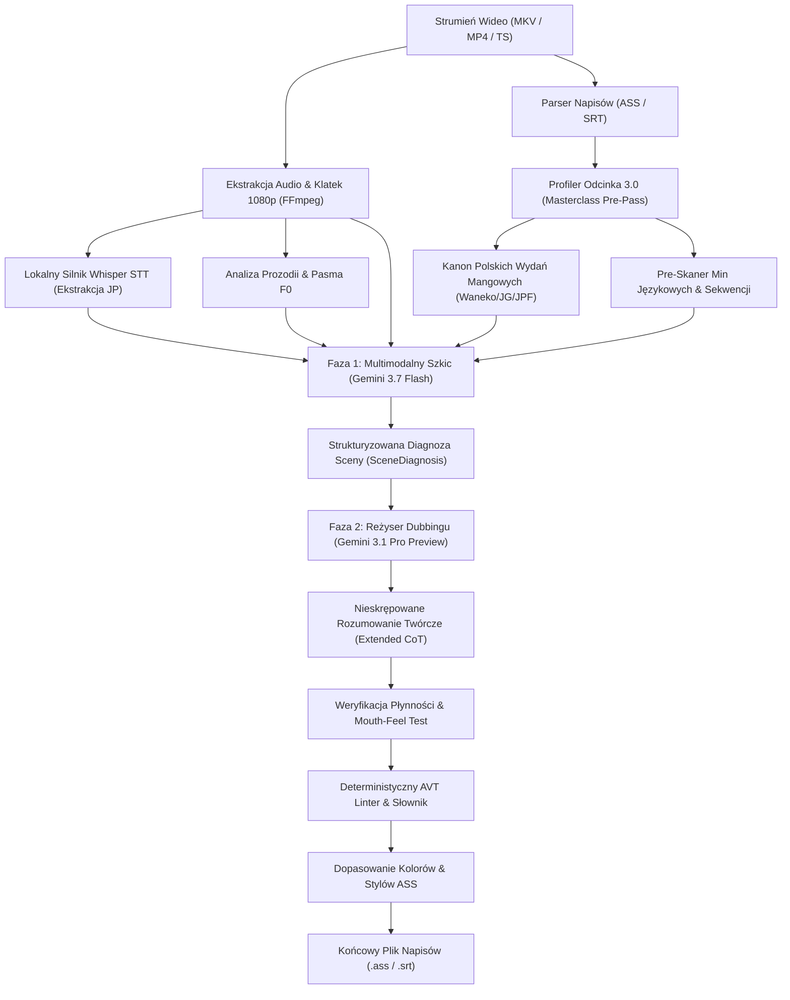

# Multimodal Video Subtitle Translation Engine (EN/JP → PL)

[](https://www.python.org/)
[](https://ai.google.dev/)
[](https://github.com/SYSTRAN/faster-whisper)
[]()
[]()

Zaawansowany, dwufazowy silnik translacji audiowizualnej (AVT) w języku Python, zaprojektowany do automatycznego tworzenia studyjnej jakości polskich napisów filmowych i anime na bazie strumienia wideo, oryginalnej ścieżki dźwiękowej (japoński dubbing) oraz angielskich skryptów dialogowych.

Silnik łączy multimodalne modele wielkoskalowe (**Google Gemini 3.7 Flash** i **Gemini 3.1 Pro Preview**), lokalną transkrypcję akustyczną (**Faster-Whisper**), wizyjną analizę kadrów 1080p (**FFmpeg OCR & Scene Gap Detector**) oraz sformalizowany **Kanon 117 Filarów Przekładu Audiowizualnego**.

---

## 🏗️ Architektura Systemu

Przepływ danych w potoku przetwarzania opiera się na architekturze wieloetapowej z pełną separacją fazy diagnozy, translacji roboczej oraz reżyserskiego szlifu literackiego:



---

## 🌟 Główne Moduły i Funkcjonalności

### 1. 🎬 Reżyserski Profiler Odcinka 3.0 (*Masterclass Pre-Pass*)
Przed rozpoczęciem tłumaczenia skrypt analizuje 100% treści odcinka w jednym przebiegu:
* **Kartoteka Obsady (`CharacterDossier`):** Ustala wiek, status społeczny, dynamikę relacji (*Uchi/Soto*) oraz japońskie zaimki osobowe (*Ore/Boku/Watashi*).
* **Skaner Min Językowych (`DangerLinePreScan`):** Prewencyjnie lokalizuje kwestie podatne na kalki semantyczne (np. fałszywi przyjaciele, pragmatyka odmowy, wieloznaczności).
* **Kanon Polskich Wydań Mangowych:** Weryfikuje oficjalną polską terminologię wydawnictw (*Waneko, Studio JG, JPF, Kotori, Hanami, Dango, Egmont*) dla zachowania pełnej zgodności nazw własnych, technik i tytułów.
* **Mapa Napięć Dramatycznych (`DramaticSequence`):** Dzieli odcinek na akty dramaturgiczne, dostosowując ekspresję językową do dynamiki scen.

### 2. 🎙️ Audio-First: Akustyczne Zakotwiczenie i Analiza Prozodii
* **Lokalny Whisper STT:** Transkrybuje oryginalną mowę aktorów (*seiyū*) w czasie rzeczywistym na lokalnym GPU/CPU.
* **Estymacja Pasma F0:** Analizuje intonację, akcent emocjonalny i natężenie głosu, tagując kwestie w promptach (szept, krzyk, sarkazm, wahanie).
* **Eliminacja Błędów Angielskich Skryptów:** Japońskie audio stanowi nadrzędną kotwicę semantyczną w przypadku rozbieżności z fansubem EN.

### 3. 👁️ Wizyjny Detektor Plansz i OCR Kadrów
* **Ekstrakcja Klatek 1080p:** Dynamicznie pobiera i skaluje klatki wideo powiązane z każdą paczką dialogową.
* **Wizyjny Detektor Luk (`VisualSignDetector`):** Skanuje przerwy między dialogami i automatycznie odczytuje napisy ekranowe, szyldy, tablice, telefony i dymki mangowe.
* **Typesetting Matcher:** Automatycznie dopasowuje paletę barw i style stylizacyjne ASS do tła wideo.

### 4. 🏛️ Kanon 117 Zunifikowanych Filarów AVT
Kompletna implementacja teorii przekładu audiowizualnego (Belczyk, Barańczak, Toury, Teoria Skopos) podzielona na 6 domen operacyjnych:
* **Domena I:** Składnia filmowa, odnominalizowanie, eliminacja zaimków osobowych.
* **Domena II:** Semiotyka ciszy (*Ma*), synchronizacja z cięciami montażowymi, rygor CPS.
* **Domena III:** Realioznawstwo, tytulatura feudalna, kanon mangowy.
* **Domena IV:** Socjolingwistyka anime (*Uchi/Soto*, triangulacja długu *Giri*, złośliwość *Iyami*).
* **Domena V:** Fonetyka emocjonalna i izomorfizm przeciągłych samogłosek (*Chōon*).
* **Domena VI:** Fleksja nazwisk obcojęzycznych i transkreacja humoru słownego.

### 5. ⚡ Infrastruktura Finansowa: Kroczący Heartbeat i Context Caching
* **Google Context Caching (KV-Cache):** Utrzymuje 39 000 tokenów Kanonu w pamięci serwerowej z rabatem **-75%** na kosztach tokenów wejściowych.
* **Kroczący Heartbeat (20m TTL):** Ruchome okno życia pamięci podręcznej odnawiane po każdej paczce; eliminuje ryzyko wygaśnięcia przy przeciążeniach serwerów (503).
* **Natychmiastowe Autoczyszczenie:** Kasuje zasoby z pamięci RAM Google natychmiast po ukończeniu pracy (**0,00 PLN opłat postojowych**).

---

## 🎛️ Profile Jakościowe

| Profil | Faza 1 (Wizja + Audio) | Faza 2 (Redakcja Reżyserska) | Szacowany Koszt (24 min) | Zastosowanie |
| :--- | :--- | :--- | :---: | :--- |
| **`[1] STANDARDOWY`** | `gemini-3.5-flash-lite` | *Brak* | **0,00 PLN** | Szybki podgląd, darmowy tier |
| **`[2] STUDYJNY FLASH`** | `gemini-3.7-flash` | `gemini-3.7-flash` | **~0,21 PLN** | Niezwykle tani, bardzo dobra jakość |
| **`[3] MASTER PRO ⭐`** | `gemini-3.7-flash` | `gemini-3.1-pro-preview` | **~2,25 PLN** | **Zalecany:** Jakość kinowa / dubbing |
| **`[4] KINOWY ULTRA 👑`** | `gemini-3.1-pro-preview` | `gemini-3.1-pro-preview` | **~4,10 PLN** | Bezwzględnie maksymalna głębokość |

---

## 🚀 Instalacja i Konfiguracja

### Wymagania wstępne
* **Python 3.10+**
* **FFmpeg** zainstalowany i dostępny w zmiennej środowiskowej `PATH`
* Klucz API **Google Gemini** ([Google AI Studio](https://aistudio.google.com/))

### Szybki start (Automatyczny instalator dla Windows)
```powershell
# Uruchom automatyczny skrypt instalacyjny:
.\setup_new_pc.bat
```

### Konfiguracja ręczna
```bash
# 1. Klonowanie repozytorium
git clone https://github.com/wooles/translator.git
cd translator

# 2. Utworzenie i aktywacja środowiska wirtualnego
python -m venv .venv
# Windows:
.venv\Scripts\activate
# Linux/macOS:
source .venv/bin/activate

# 3. Instalacja zależności
pip install -r requirements.txt

# 4. Konfiguracja zmiennych środowiskowych
cp .env.example .env
# Uzupełnij plik .env o klucz: GEMINI_API_KEY=twój_klucz_api
```

---

## 💻 Sposób Użycia

### 1. Graficzny Interfejs Użytkownika (GUI)
Aplikacja posiada pełnoprawne środowisko graficzne oparte na **PySide6**:
```powershell
python gui_app.py
```
* Wsparcie dla techniki Drag & Drop (wideo i napisy).
* Podgląd tłumaczenia w czasie rzeczywistym z metrykami CPS i diagnozą sceny.
* Interaktywne dodawanie reguł użytkownika do pamięci Few-Shot.
* Monitor kosztów i zużycia tokenów na żywo.

### 2. Wiersz Poleceń (CLI)
```powershell
# Podstawowe tłumaczenie z domyślnym profilem Master Pro:
python main.py "sciezka/do/odcinka.mkv"

# Wybór profilu jakości:
python main.py "odcinek.mkv" --profile pro       # Master Pro
python main.py "odcinek.mkv" --profile flash     # Studyjny Flash
python main.py "odcinek.mkv" --profile ultra     # Kinowy Ultra

# Wybór stylu honoryfikatorów:
python main.py "odcinek.mkv" --honorifics-mode 1  # Styl Anime (-kun, -san, -chan)
python main.py "odcinek.mkv" --honorifics-mode 2  # Styl Netflix / Czysta Polszczyzna

# Tłumaczenie całej serii (Kolejka Sezonowa):
python main.py "sciezka/do/katalogu_z_seria/"

# Automatyczne odtworzenie po zakończeniu tłumaczenia:
python main.py "odcinek.mkv" --play
```

---

## 🧪 Testy i Weryfikacja Systemu

Projekt zawiera rozbudowany pakiet testów jednostkowych i integracyjnych pokrywający wszystkie moduły potoku:
```powershell
python test_system.py
```
Zakres weryfikacji testowej:
* Integralność schematów Pydantic i modeli `SceneDiagnosis`
* Kompletność i brak kolizji w 117 Filarach AVT
* Izolacja i odświeżanie Google Context Caching (SHA-256)
* Odporność Lintera na błędy fleksyjne i kalki leksykalne
* Precyzja estymacji finansowej w `pricing_guard.py`
* Bezpieczeństwo i spójność bazy Translation Memory

---

## 📄 Licencja

Projekt udostępniany na licencji MIT. Szczegóły znajdują się w pliku `LICENSE`.
