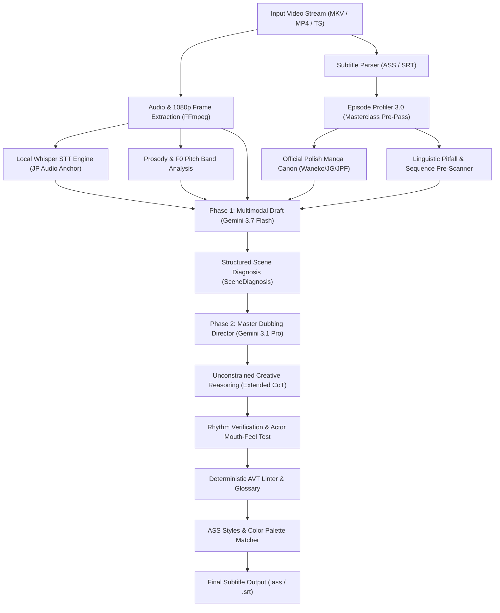

# Multimodal Video Subtitle Translation Engine (EN/JP → PL)

[](https://www.python.org/)
[](https://ai.google.dev/)
[](https://github.com/SYSTRAN/faster-whisper)
[]()
[]()

An advanced, two-phase multimodal Audiovisual Translation (AVT) engine engineered in Python. It automatically creates studio-quality, natural Polish subtitles from raw video streams, original Japanese dialogue audio (*seiyū*), and reference English subtitle files.

The architecture combines multimodal foundation models (**Google Gemini 3.7 Flash** and **Gemini 3.1 Pro Preview**), offline acoustic speech recognition (**Faster-Whisper**), 1080p visual scene extraction (**FFmpeg OCR & Scene Gap Detector**), and a formally codified **117-Pillar Audiovisual Translation Canon**.

---

## 🏗️ System Architecture

The pipeline uses a multi-stage architecture with full separation of scene diagnosis, multimodal draft generation, and creative dubbing directorial refinement:



---

## 🌟 Key Modules & Core Capabilities

### 1. 🎬 Masterclass Episode Profiler 3.0 (*Pre-Pass Engine*)
Before processing dialogue batches, the engine analyzes 100% of the episode script in a holistic single pass:
* **Cast Dossier (`CharacterDossier`):** Maps speaker age, social hierarchy, interpersonal relationships (*Uchi/Soto*), and Japanese personal pronouns (*Ore/Boku/Watashi*).
* **Linguistic Pitfall Scanner (`DangerLinePreScan`):** Proactively detects false friends, refusal pragmatics, homophones, and cultural translation traps.
* **Official Polish Manga Publishing Canon:** Enforces locked, canonical terminology established by official Polish publishers (*Waneko, Studio JG, JPF, Kotori, Hanami, Dango, Egmont*) for spellings, attacks, titles, and proper nouns.
* **Dramatic Sequence Matrix (`DramaticSequence`):** Identifies emotional act structures and comedic/dramatic beats to adapt register and pacing dynamically.

### 2. 🎙️ Audio-First: Acoustic Anchoring & F0 Prosody Analysis
* **Offline Whisper STT:** Transcribes original *seiyū* speech on local GPU/CPU hardware with zero cloud API latency.
* **F0 Pitch Contour & Diarization:** Detects acoustic emotional markers (screams, whispers, hesitations, sarcasm) and injects prosody cues directly into the prompt context.
* **Semantic Ground Truth:** Original Japanese audio serves as the definitive semantic anchor whenever English fan scripts are imprecise, localized, or truncated.

### 3. 👁️ Visual Scene Gap Detector & OCR
* **1080p Frame Extraction:** Dynamically extracts and downscales video keyframes aligned with dialogue batches.
* **Visual Scene Gap Detector (`VisualSignDetector`):** Detects non-dialogue intervals and extracts on-screen signs, blackboard text, smartphone messages, and manga speech bubbles.
* **Typesetting Matcher:** Automatically matches ASS subtitle typography, alignment, and color palettes to on-screen graphics.

### 4. 🏛️ Unified 117-Pillar Audiovisual Translation Canon
A rigorous implementation of modern translation studies (Belczyk, Barańczak, Toury, Vermeer's Skopos Theory) divided into 6 distinct operational domains:
* **Domain I:** Natural screen syntax, verbalization (de-nominalization), pronoun reduction.
* **Domain II:** Semiotics of silence (*Ma*), shot-cut synchronization, strict CPS limits.
* **Domain III:** Feudal honorifics, cultural realia, manga canon compliance.
* **Domain IV:** Anime pragmatics (*Uchi/Soto*, *Giri* obligation triangulation, *Iyami* sarcasm).
* **Domain V:** Emotional phonetics and vowel elongation isomorphism (*Chōon*).
* **Domain VI:** Polish foreign name declension rules and Baranczak-style poetic transcreation.

### 5. ⚡ Financial Optimization: Rolling Heartbeat & Context Caching
* **Google Context Caching (KV-Cache):** Persists the 39,000-token System Canon in Google's server RAM with a **-75%** input token discount.
* **Ephemeral Rolling Keep-Alive (20m TTL):** Floating cache expiration window automatically refreshed upon batch completion or retry, guaranteeing uninterrupted execution even during long server throttles (503s).
* **Immediate Zero-Cost Cleanup:** Automatically deletes cache objects upon completion or interruption (**0.00 PLN idle storage fees**).

---

## 🎛️ Quality Profiles

| Profile | Phase 1 (Vision + Audio) | Phase 2 (Dubbing Director) | Est. Cost (24 min) | Target Use Case |
| :--- | :--- | :--- | :---: | :--- |
| **`[1] STANDARD`** | `gemini-3.5-flash-lite` | *None* | **$0.00 / 0.00 PLN** | Ultra-fast preview, 100% Free Tier |
| **`[2] STUDIO FLASH`** | `gemini-3.7-flash` | `gemini-3.7-flash` | **~$0.05 / 0.21 PLN** | High speed, extremely economical |
| **`[3] MASTER PRO ⭐`** | `gemini-3.7-flash` | `gemini-3.1-pro-preview` | **~$0.56 / 2.25 PLN** | **Recommended:** Cinema & dubbing grade |
| **`[4] CINEMA ULTRA 👑`** | `gemini-3.1-pro-preview` | `gemini-3.1-pro-preview` | **~$1.02 / 4.10 PLN** | Maximum depth, dual Pro inference |

---

## 🚀 Installation & Setup

### Prerequisites
* **Python 3.10+**
* **FFmpeg** installed and accessible via system `PATH`
* **Google Gemini API Key** ([Google AI Studio](https://aistudio.google.com/))

### Automated 1-Click Setup (Windows)
```powershell
# Run the automated installer:
.\setup_new_pc.bat
```

### Manual Setup
```bash
# 1. Clone repository
git clone https://github.com/wooles/translator.git
cd translator

# 2. Create and activate virtual environment
python -m venv .venv
# Windows:
.venv\Scripts\activate
# Linux/macOS:
source .venv/bin/activate

# 3. Install dependencies
pip install -r requirements.txt

# 4. Configure environment variables
cp .env.example .env
# Set your API key in .env: GEMINI_API_KEY=your_api_key_here
```

---

## 💻 Usage

### 1. Graphical User Interface (GUI)
Launch the comprehensive **PySide6** desktop interface:
```powershell
python gui_app.py
```
* Native Drag & Drop support for video and subtitle files.
* Real-time translation inspection with CPS monitors and scene diagnosis views.
* Interactive Few-Shot feedback manager to add persistent custom translation rules.
* Live token usage and real-time financial tracking.

### 2. Command Line Interface (CLI)
```powershell
# Translate video with default Master Pro quality:
python main.py "path/to/episode.mkv"

# Select quality profile:
python main.py "episode.mkv" --profile pro       # Master Pro
python main.py "episode.mkv" --profile flash     # Studio Flash
python main.py "episode.mkv" --profile ultra     # Cinema Ultra

# Select honorific style:
python main.py "episode.mkv" --honorifics-mode 1  # Anime Fansub style (-kun, -san, -chan)
python main.py "episode.mkv" --honorifics-mode 2  # Netflix / Clean Polish style

# Batch season queue:
python main.py "path/to/season_directory/"

# Auto-launch media player upon completion:
python main.py "episode.mkv" --play
```

---

## 🧪 Testing & Verification

The repository includes a comprehensive unit and integration test suite:
```powershell
python test_system.py
```
Test verification scope:
* Pydantic schemas and `SceneDiagnosis` model validation.
* Completeness and conflict-free execution of all 117 AVT Pillars.
* Google Context Cache SHA-256 isolation and rolling keep-alive behavior.
* Linter resilience against morphological and grammatical anglicisms.
* Pricing guard token calculations and empirical budget verification.
* Translation Memory database querying and bisect alignment.

---

## 📄 License

Distributed under the MIT License. See `LICENSE` for details.
